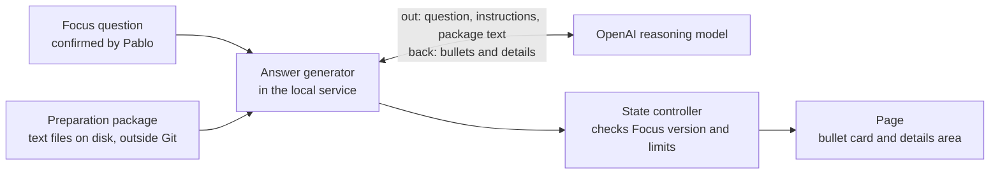

# Proposed answer and its context

Alice.Good.Meetings prepares each proposed answer in the local service, from the Focus question and an interview preparation package whose text is sent to OpenAI.
Most of this was decided by Pablo on 16 November 2026 and the rest is proposed by Architecture for his review. The table below keeps the two apart; his words are as relayed by 00 Governance and, for the first three rows, recorded in the [brief addendum](../../../07-planning/03.6.3-sprint-003-brief-addendum.md).

*What is read, what leaves the Mac and what reaches the page. Neither the key nor the package text reaches the page.*

## Decided and proposed

| Point | Status | Basis |
| --- | --- | --- |
| The answer is built from the Focus question and a prepared context; for this sprint, an interview preparation package with his résumé and other documents, sent to OpenAI | Selected | Pablo: "we will send a context that we will build accrodingly" |
| One model call produces the bullets and the details; two calls are a possible later change | Selected | Pablo: "for now is one call" |
| Every change to the Focus question brings a new answer | Selected | Pablo: "Yes, always replace" |
| The answer appears automatically when a Focus question is set | Carried forward | Sprint criterion 3 |
| A separate answer generator in the local service makes the call | Proposed | [Where the answer is generated](01-where-answers-are-generated.md) |
| The package is kept in the project at `poc/context/interview/`, ignored by Git | Selected | Pablo: "In the project, Git-ignored (Recommended)"; see [the preparation package](02-preparation-package.md) |
| The package is plain text or Markdown, up to 20,000 characters | Selected | Pablo accepted this default: "Accept all" |
| Without a package Alice gives general points, labelled as general | Selected | Pablo accepted this default: "Accept all" |
| A package over the limit is not used at all; other meeting kinds get their own folder later | Proposed | [The preparation package](02-preparation-package.md) |

## Why this needs a record

Until now only audio, recent transcript and the questions left the Mac. Personal documents are a new kind of data, sent again with every confirmed question, so the choice sets a privacy boundary, a cost and a delay.
Where the call is made decides whether the key stays in the service and whether the Live question slows down.

## Consequences

- The data statements in the root `AGENTS.md` and `poc/README.md` become wrong when this ships. [Data statements](03-data-statements.md) gives the wording their owners need.
- Each confirmed question, including a rewording, is one billable request that carries the whole package.
- An answer may state about Pablo only what the package contains. Without a package it offers structure and nothing about him.
- Tests and the billable browser smoke use a synthetic package, never the real one. The package never holds benchmark recordings, their transcripts, evaluator labels or reference answers.
- This checkout sits in a Google Drive folder, so the package is also synced to Pablo's Drive. He chose the location with that stated; the outside-the-checkout option is not selected.

## Revisit when

- The live session, where Pablo chose to learn the [answer delay](../../03.2-answer-delay-question.md), shows the bullets arriving after he has started to answer.
- Pablo wants his documents kept outside the checkout, or supplies them in a format that is not plain text.
- A second kind of meeting needs its own context.
- An answer states something about him that the package does not contain.

Status: draft of 16 November 2026, updated the same day with his later answers. He was told he can change any accepted default at the preview or the specification review. Selection records his stated choices; it does not approve these bytes, and nothing here is implemented.
[Where the answer is generated](01-where-answers-are-generated.md) · [The preparation package](02-preparation-package.md) · [Data statements](03-data-statements.md) · [Proposed answer design](../../01.3-proposed-answer.md) · [Architecture index](../../README.md)
