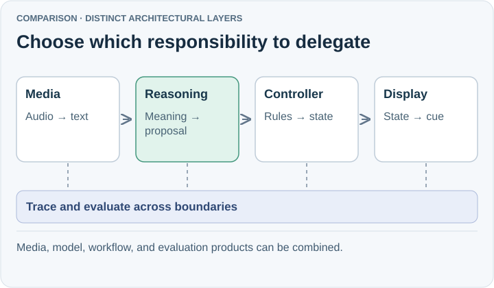

# Compare the responsibility before the framework

SpeakerCoach needs continuous observations, accurate interpretation, authoritative state, and useful visual feedback.
Choose a framework for the complexity it removes from one of these responsibilities. Several products below can complement the selected SDK.

## Products considered

| Product | Decision now | Responsibility evaluated |
| --- | --- | --- |
| [OpenAI Agents SDK](02-openai-agents-sdk.md) | Selected for the POC | Agent loop and structured proposals |
| [PydanticAI](03-pydantic-ai.md) | Deferred alternative | Typed Python agents and provider flexibility |
| [LangChain](04-langchain.md) | Deferred alternative | Model/tool integrations and agent loops |
| [LangGraph](05-langgraph.md) | Deferred workflow option | Durable, branching execution workflows |
| [LangSmith](06-langsmith.md) | Optional complement | Tracing and evaluation |
| [LiveKit Agents](07-livekit-agents.md) | Deferred media option | Realtime media and room participation |
| [Pipecat](08-pipecat.md) | Deferred media option | Streaming voice processing |
| [Vercel AI SDK](09-vercel-ai-sdk.md) | Deferred TypeScript alternative | TypeScript model and UI interfaces |
| [Google Agent Development Kit](10-google-adk.md) | Deferred agent-framework alternative | Agent sessions, tools, workflows and live integration |
| [Gemini Live API](11-gemini-live-api.md) | Deferred realtime-service alternative | Continuous audio/vision service |
| [Claude Agent SDK](12-claude-agent-sdk.md) | Deferred harness alternative | Autonomous tool-execution harness |
| [Anthropic client SDK](13-anthropic-client-sdk.md) | Deferred reasoning alternative | Direct Claude reasoning calls |

## What matters in this decision

The existing service uses Node.js and one tool-free structured reasoning call. Reusing it avoids migration before the POC answers its practical questions.
Interview phases describe the conversation; workflow nodes describe work to execute. A small phase machine alone is insufficient reason to adopt LangGraph or another workflow engine.
Native SDK access can expose provider-specific features, but cannot add capabilities missing from the model/API. A common interface can also hide useful differences; verify each required path.
No relative latency, accuracy, or price advantage is established by this review.

## A fair future comparison

First send the same incremental transcript snapshots to each reasoner and apply the same controller rules.
Then compare complete audio paths with the same progressively released recording; future audio and evaluator reference answers stay inaccessible to the system.
Measure question fidelity and retention, obsolete or incorrect updates, time to a useful visible cue, and total cost per interview.
Keep browser timing distinct from model-call timing; use the [evaluation strategy](../../../04-benchmarks-and-eval-strategy/01-evaluation-strategy.md) for the full protocol.

Documentation was consulted during the October 2026 discussion; feature and language support must be rechecked when an alternative is implemented.
[Decision](README.md)

