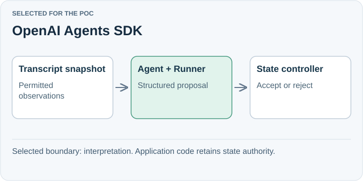

# OpenAI Agents SDK

**Selected for the POC.** Keep one interview reasoner inside the local Node service. The SDK runs the agent loop while SpeakerCoach owns audio intake, accepted state, and the display. Its tool and handoff capabilities leave room for later growth.

## Trade-off for SpeakerCoach

The present reasoner makes one structured call and has no tools. A direct model API call remains a credible simpler baseline; the SDK has not been shown to improve model accuracy or latency.

The [current reasoner](../../../../../poc/agent.mjs) uses `Agent`, `Runner`, and a Zod output schema. The [smoke report](../../../../../poc/RESULTS.md) shows an audio-dependent reply, with broader validation still incomplete.

## When to reconsider

Revisit if measured SDK overhead, missing capabilities, or maintenance effort obstructs an acceptance criterion. Keep the input snapshot and proposal schema independent of the SDK.

Sources: [Official SDK guide](https://developers.openai.com/api/docs/guides/agents/sdk).

[Decision](README.md) · [Comparison](01-comparison.md)

