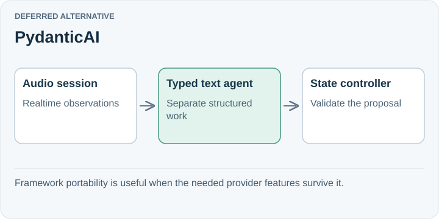

# PydanticAI

**Deferred alternative.** A Python agent framework centered on typed inputs, dependencies, structured outputs, and multiple model providers. It could suit a Python service where validation and provider flexibility are recurring requirements.

## Trade-off for SpeakerCoach

Our existing service is Node.js, so adoption would change the implementation stack. Realtime sessions do not directly support normal `output_type` and output validators; the documented pattern delegates structured work to a text agent.

This limitation alone does not prove native SDKs solve structured realtime output: support also depends on the underlying model/API. Our transcript-to-text-reasoner separation can work with either approach.

## When to reconsider

Revisit if Python becomes the service language or a concrete multi-provider requirement outweighs migration work. Test the exact realtime and structured-output path, not framework-wide feature labels.

Sources: [Structured output](https://pydantic.dev/docs/ai/core-concepts/output/) · [Realtime limitations](https://pydantic.dev/docs/ai/realtime/overview/).

[Decision](README.md) · [Comparison](01-comparison.md)

