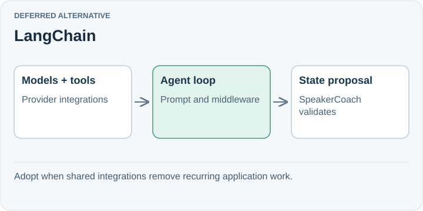

# LangChain

**Deferred alternative.** LangChain supplies an agent loop built from a model, tools, prompts, and middleware, with integrations across providers. It could reduce integration work once coaching uses several tools and data sources.

## Trade-off for SpeakerCoach

The current reasoner has no tools. Moving to another agent abstraction now would add adaptation and debugging work without a demonstrated integration problem to remove.

LangChain is an agent framework, not only a prompt-chain or retrieval library. It can be evaluated separately from LangSmith; adopting its tracing platform does not require adopting this runtime.

## When to reconsider

Revisit when maintaining model/tool integrations becomes substantial. Compare an actual coaching workflow; do not assume LangChain is slower or faster without measurement.

Sources: [LangChain overview](https://docs.langchain.com/oss/javascript/langchain/overview).

[Decision](README.md) · [Comparison](01-comparison.md)

