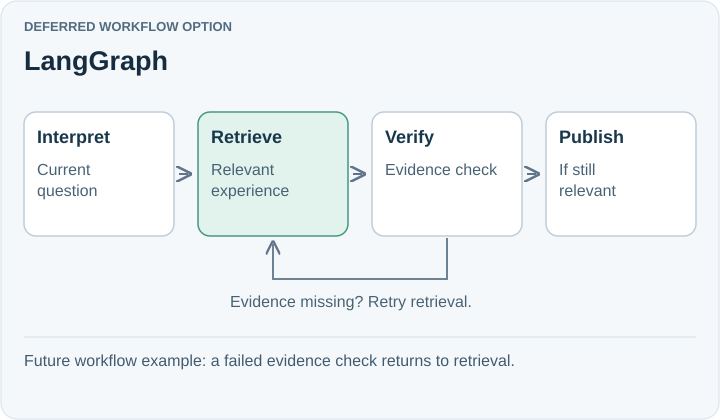

# LangGraph

**Deferred workflow option.** LangGraph coordinates explicit workflows containing ordinary code and model calls, with persistence, resumability, and human intervention. It can be used without LangChain.

## Trade-off for SpeakerCoach

Interview phases describe the conversation; a graph describes work to execute. `GREETINGS`, `QUESTION`, and `ANSWER` alone do not justify a workflow engine. Checkpoints and graph state introduce another state model to maintain.

Even with durable execution, SpeakerCoach must reject advice tied to an obsolete question. Workflow recovery does not decide semantic relevance.

## When to reconsider

Revisit when coaching branches, retries, waits for review, or must resume work after failure. A future retrieve–generate–verify workflow is a concrete candidate.

Sources: [LangGraph overview](https://docs.langchain.com/oss/javascript/langgraph/overview).

[Decision](README.md) · [Comparison](01-comparison.md)

