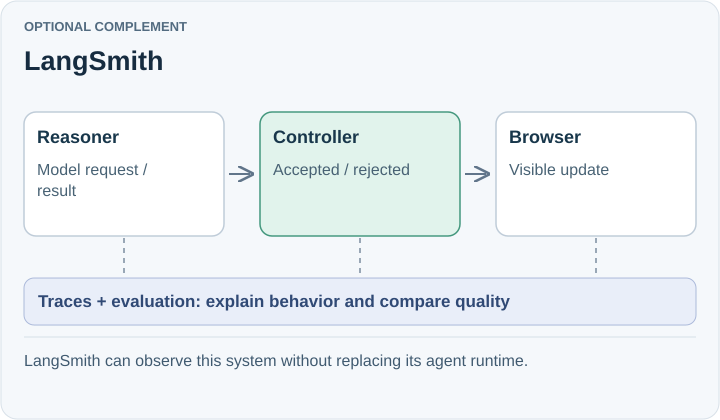

# LangSmith

**Optional complement.** LangSmith provides traces, quality monitoring, and evaluation workflows across providers and frameworks. It could help explain poor suggestions and compare prompts while the OpenAI Agents SDK remains in place.

## Trade-off for SpeakerCoach

Instrumenting and operating a tracing service adds integration work and decisions about which interview data to retain. Agent traces alone do not establish microphone-to-visible-cue delay.

The POC currently disables SDK tracing. LangSmith has not been integrated or evaluated here. Browser timing and accepted state revisions must remain part of any end-to-end measurement.

## When to reconsider

Revisit when existing logs cannot explain failures or repeated replay evaluations need shared datasets and comparison tools.

Sources: [LangSmith observability](https://docs.langchain.com/langsmith/observability).

[Decision](README.md) · [Comparison](01-comparison.md)

