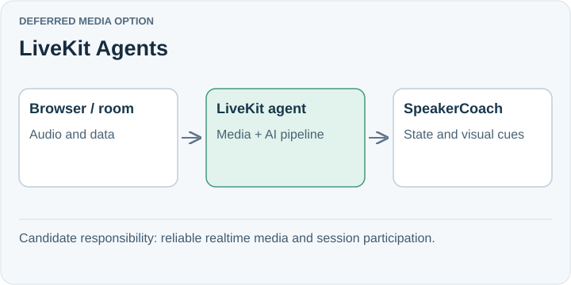

# LiveKit Agents

**Deferred media option.** LiveKit Agents brings Python or Node programs into realtime rooms, carrying media and data through AI pipelines. It is relevant if reliable media delivery, participant connections, or meeting interaction becomes the dominant engineering problem.

## Trade-off for SpeakerCoach

A room and agent-session model introduces infrastructure and lifecycle integration beyond our current single-browser local service. The benefit must justify that operational work.

Media infrastructure does not by itself identify who is speaking in a mixed microphone recording. Speaker attribution and interview-state correctness still need their own evidence.

## When to reconsider

Revisit when connection handling, multiple participants/devices, or voice interaction is harder to maintain than the reasoning layer.

Sources: [LiveKit Agents introduction](https://docs.livekit.io/agents/).

[Decision](README.md) · [Comparison](01-comparison.md)

