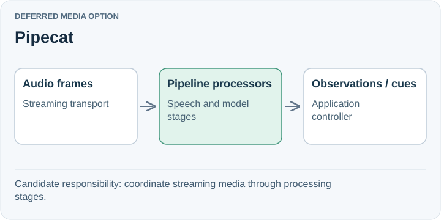

# Pipecat

**Deferred media option.** Pipecat assembles streaming voice and multimodal pipelines, with transports, speech/model services, turn detection, and interruption handling. It is a serious option when audio behavior needs more control.

## Trade-off for SpeakerCoach

Adoption means integrating a new pipeline and transport model. SpeakerCoach currently delivers private visual guidance, so some conversational speech features may offer little immediate value.

A voice framework can complement model reasoning. It does not remove the need to preserve an active question or reject late suggestions.

## When to reconsider

Revisit when speech-service composition, turn handling, or transport behavior becomes a demonstrated bottleneck.

Sources: [Pipecat overview](https://www.pipecat.ai/).

[Decision](README.md) · [Comparison](01-comparison.md)

