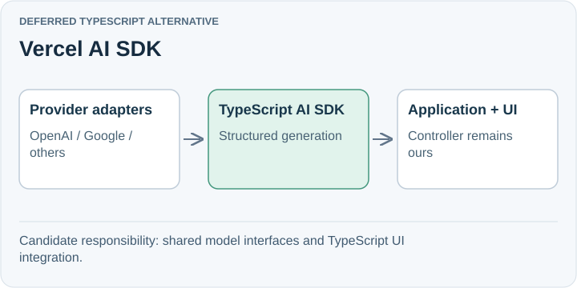

# Vercel AI SDK

**Deferred TypeScript alternative.** Vercel AI SDK supplies TypeScript interfaces for model providers, structured generation, tools, and UI integration. It is a plausible alternative if we need provider flexibility while preserving the Node.js stack.

## Trade-off for SpeakerCoach

A common provider interface still requires checking feature differences for our exact models. Switching abstractions creates work unless portability or UI integration solves an actual problem.

Evaluate it at the reasoning/UI boundary. Do not infer that model token streaming also supplies continuous microphone transport.

## When to reconsider

Revisit when switching providers becomes a recurring requirement or its UI utilities materially simplify the product.

Sources: [AI SDK introduction](https://ai-sdk.dev/docs/introduction).

[Decision](README.md) · [Comparison](01-comparison.md)

