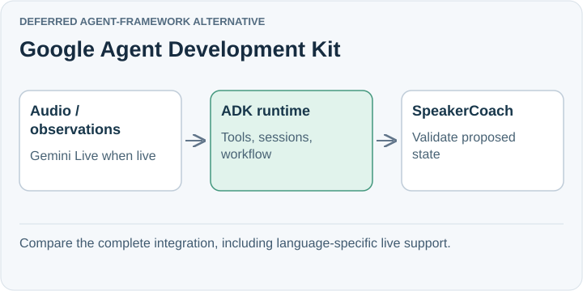

# Google Agent Development Kit

**Deferred agent-framework alternative.** Google ADK combines agents, tools, sessions, workflows, evaluation, and live-agent integration. It supports Gemini and other model providers, making it a credible alternative as coaching orchestration grows.

## Trade-off for SpeakerCoach

Its general TypeScript availability does not establish live-feature parity: the reviewed live-agent documentation lists Python and Java. A migration must check the exact language and feature path.

ADK's live integration currently uses Gemini Live and manages connection, tool execution, and session state. General model portability does not imply portable live-audio support.

## When to reconsider

Revisit if Gemini Live plus ADK offers a measured improvement in live behavior or reduces substantial session/workflow code.

Sources: [ADK overview](https://adk.dev/) · [Live-agent capabilities](https://adk.dev/live/).

[Decision](README.md) · [Comparison](01-comparison.md)

