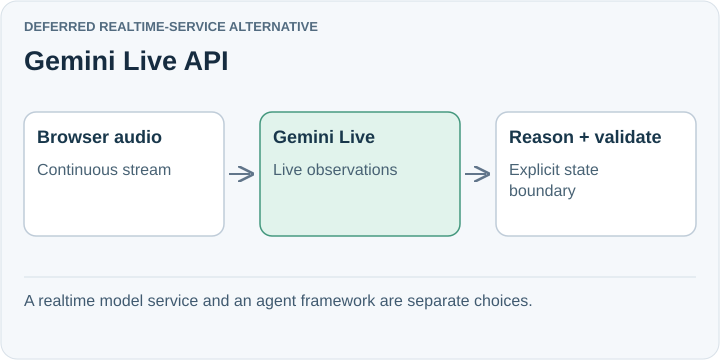

# Gemini Live API

**Deferred realtime-service alternative.** Gemini Live accepts continuous audio, images, and text through a stateful WebSocket session, with transcription and tool use. It is an alternative for live perception and interaction, rather than a replacement for every application component.

## Trade-off for SpeakerCoach

The reviewed Live API does not support `responseSchema` or `responseJsonSchema`. Native access therefore does not supply schema-constrained interview-state output through that configuration.

A native audio path may retain vocal information that a plain transcript loses. Whether that improves question retention or advice remains unmeasured for SpeakerCoach.

## When to reconsider

Revisit through progressive audio replay if its transcription, responsiveness, or audio understanding could improve the experience. Keep structured reasoning and controller validation explicit.

Sources: [Gemini Live overview](https://ai.google.dev/gemini-api/docs/live-api) · [Configuration limitations](https://ai.google.dev/api/live).

[Decision](README.md) · [Comparison](01-comparison.md)

