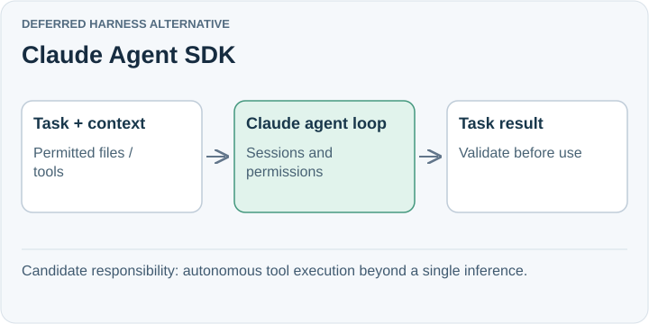

# Claude Agent SDK

**Deferred harness alternative.** Claude Agent SDK embeds the agent loop and context management behind Claude Code in a process we operate. It includes tools, permissions, sessions, hooks, and subagents in Python and TypeScript.

## Trade-off for SpeakerCoach

Its strongest fit here would be autonomous work involving tools, files, and multiple steps. Our current tool-free interpretation call uses little of that capability.

It is a broader execution harness than a plain model client. The present audio-to-transcript boundary would still need a separate speech solution for the documented Claude model inputs.

## When to reconsider

Revisit if the helper needs to investigate personal material or perform substantial delegated tasks and those built-in capabilities reduce custom work.

Sources: [Claude Agent SDK](https://code.claude.com/docs/en/agent-sdk/overview) · [Claude model inputs](https://platform.claude.com/docs/en/models/overview).

[Decision](README.md) · [Comparison](01-comparison.md)

