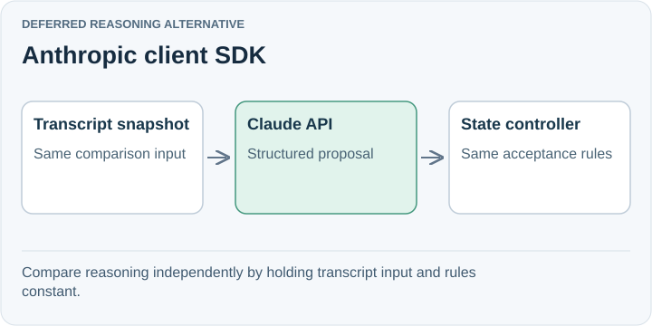

# Anthropic client SDK

**Deferred reasoning alternative.** The client SDK calls Claude's Messages API directly. Structured outputs make it a straightforward candidate for producing the phase, question, and evidence references expected by our controller.

## Trade-off for SpeakerCoach

The reviewed Claude model documentation lists text and image input, with text output. Use a separate streaming transcription service for audio; plain transcripts do not preserve every vocal cue.

This experiment can replace only the reasoning adapter. It does not require Claude Agent SDK or a change to the accepted-state controller. No comparative model benchmark has been run for this decision.

## When to reconsider

Revisit if Claude improves question interpretation or advice on the same incremental transcript inputs, within the required delay and cost.

Sources: [Client SDKs](https://platform.claude.com/docs/en/cli-sdks-libraries/overview) · [Structured outputs](https://platform.claude.com/docs/en/build-with-claude/structured-outputs) · [Model modalities](https://platform.claude.com/docs/en/models/overview).

[Decision](README.md) · [Comparison](01-comparison.md)

