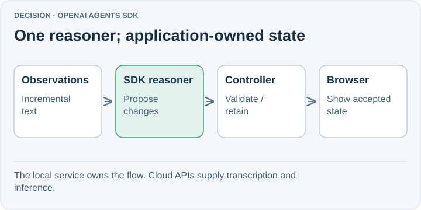

# Use Open AI Agent SDK

Use the OpenAI Agents SDK for SpeakerCoach's current proof of concept, running inside the local Node.js service on the MacBook.
Cloud services perform transcription and model inference; the application controls the interview state and the browser display.
The user selected this direction in the architecture discussion on 26 October 2026. This record explains that decision and its limits.

## Why this is sufficient now

The first outcome is to capture and retain the interviewer's question while Pablo answers.
The existing SDK integration already returns structured, audio-dependent proposals. No demonstrated requirement currently justifies replacing it.
Keep audio intake, reasoning, and state validation separate so that future evidence can change one component without redesigning the whole application.

## Consequences and limits

We keep the current JavaScript/Node implementation and one bounded reasoning agent. The SDK does not establish speaker identity, capture meeting audio, or guarantee useful advice.
The [POC report](../../../../../poc/RESULTS.md) records a synthetic browser smoke; physical microphone behavior, isolated benchmark replay, and human usefulness still need evidence.
A direct OpenAI model call remains a simpler baseline while the reasoner has no tools. Codex remains a development tool, not a required interview runtime.
This decision selects the POC harness; it does not freeze a model, select a permanent provider, or establish production readiness.

## Read the supporting comparison

Start with [01 — How we compared the options](01-comparison.md), then use its product links for the short assessments.
Each product page states its fit, trade-off, and concrete reason to reconsider it, with an editable SVG diagram and primary sources.
The comparison is an architectural assessment, not a performance ranking; none of the alternatives has been benchmarked against this POC.

Revisit when testing exposes a material SDK limitation, provider requirement, workflow need, or media problem.
Next evidence: correct question retention, timely visible cues, handling of interruptions/failures, and usefulness during real answering.
The earlier [architecture proposal](../../01-architecture.md) provides context; this record advances its harness choice from candidate to selected for the POC.

