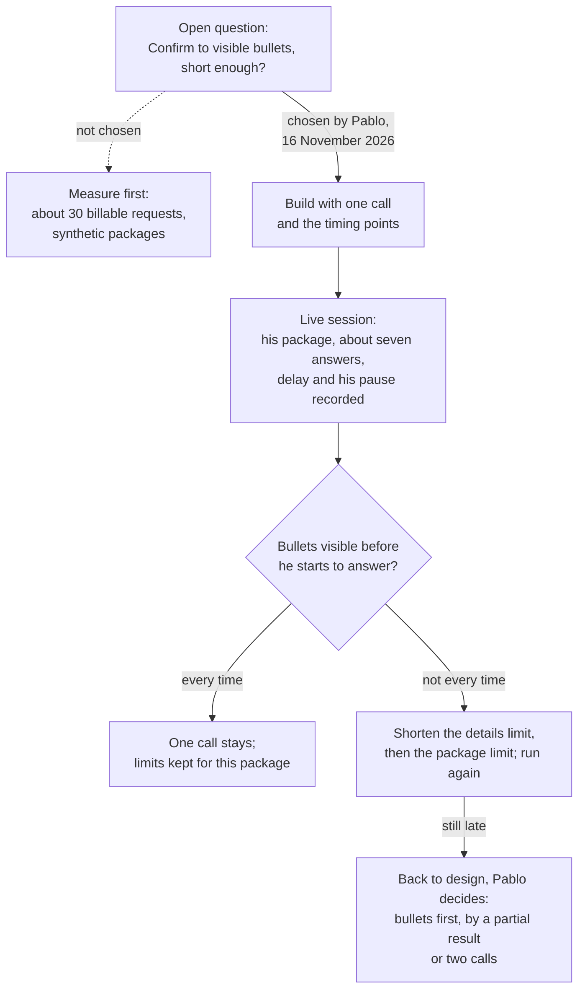

# SPRINT-003: no answer-delay experiment before the build

SPRINT-003 gives Alice (Alice.Good.Meetings) a proposed answer: short bullets beside the Focus question and details below, from one model call that also carries Pablo's interview preparation package.
Nobody knows how long the bullets take to appear after Confirm. This page records the decision not to measure that before the feature is built, what it costs, and what the sprint's live session must then show.

*The chosen path and the result that would return the design to Architecture. The dashed path is the experiment that will not run.*

## The decision

00 Governance asked Pablo on 16 November 2026 whether to measure the answer delay before building, at about thirty billable requests with synthetic packages, or to learn it in his live session at the end of the sprint. His answer, as relayed to this stage: "Learn it in the live session".
So no Stage 06 experiment runs before implementation. The question stays the one framed in Architecture's [answer delay question](../05-high-level-design-and-architecture/03.2-answer-delay-question.md): the time from the service accepting Confirm (t0) to the page reporting the bullets rendered (t3).

## Why it is reasonable, and what it costs

- An experiment could not settle the question alone. The delay is compared with the pause Pablo takes before answering, and that number comes only from a live session or from his own estimate.
- A synthetic package gives the delay for an invented size; the live session gives it for the package he really uses.
- The experiment needs an answer generator, which is the feature's own code written before its design is specified.
- The design keeps the exit open: the result holds the bullets first, so details can later arrive after them without changing the result's shape ([proposed answer](../05-high-level-design-and-architecture/01.3-proposed-answer.md)).

The cost: a delay that is too long is found only after the feature is built and tested. At best the fix is changed settings and a second billable live session. At worst it changes the generator, the controller's handling of results and their tests.

## What stays unknown until then

The only timing on record is 1482 ms for a one-sentence reply to a small input in one synthetic trial ([POC results](../../../poc/RESULTS.md)). An answer request sends the whole package and returns bullets plus details, and the bullets wait for the details.
No acceptable delay is agreed. Two settings are therefore provisional: the details length limit, which bounds how long the bullets wait, and the 20,000-character package limit that Architecture proposes.

## What the live session will show, and its limits

The [live session script](../04-benchmarks-and-eval-strategy/03.6.1-sprint-003-live-session.md) records the answer delay at each of its seven steps, to compare with the time from Confirm to his next speech.
That is one user, one session, one package size and about seven values on one network on one day. It can show that the delay was too long that day. It cannot show a typical or a slowest delay, or tell the effect of package size from that of details length.
The evidence exists only if the timing points and the text-free answer events of the design are built with the feature. Today's audit log times Confirm and the end of each transcribed utterance, not the moment speech starts, so the pause needs a speech-start time or a number Pablo states. Both are conditions for the Stage 07 plan and the Stage 08 specification.
Pablo's live pass rule of 18 November 2026 reports delay and fit but does not include them, so a session can pass while the bullets arrive late. The delay limit and the return trigger below therefore stay proposals for Pablo, outside the rule.

## What sends the design back

Proposed by this stage for Pablo's agreement, since no limit exists: the design is reconsidered if in any step the bullets became visible after he had started to answer, or if he says they came too late to use.
The order is Architecture's: a shorter details limit, then a smaller package limit, each measured again. If the bullets are still late, showing them from a partial result or making two calls changes what he selected ("for now is one call") and is his decision.

## Other uncertainties in the twelve commitments

Refreshed on 18 November 2026 for the amended baseline of [brief v2](../07-planning/03.8-sprint-003-review-brief-v2.md) (SHA-256 `58a423ee370518772ceb2e6a51370dfb62048a8f89e49b90a9b2fade49257f16`), which has twelve IDs. The decision holds: still no POC, and no new experiment is proposed. None of the other eleven needs one before implementation.

| ID | Why no experiment | How it is settled instead |
| --- | --- | --- |
| S003-LAYOUT, PREVIEW, GLANCE | Preference and readability, not a technical unknown | The preview Pablo approves; the glance check |
| S003-ANSWER, NOKEY, DETAILS | Deterministic behavior | Service tests with the generator injected |
| S003-TESTS, RUN | Deterministic | `node --test`; a shell check of `bash poc/alice-run.sh` |
| S003-PAGECHECK | A build and test task, not an unknown | Scripted page check of all seven answer states. It needs fixtures: the generator and the transcription connection are injected, so no OpenAI request is made (Architecture amendment A4, 05 review v2). Not a stage 06 experiment |
| S003-STATEMENTS | A documentation match | Compared with the request-body assertion, as the 04 review v2 proposes |
| S003-LIVE | It is the measurement | The 18 November pass rule: every step meets its expectation, no stale answer, every statement about him in the package, glance, and he would keep it on. He alone judges statements about himself |

One material uncertainty is unmeasured: whether instructions alone keep the model from stating something about Pablo that the package does not contain (S003-CONTEXT). It is covered by the live pass rule, so one such statement fails the session, and this stage still recommends learning it in steps 3 and 4. Seven answers can show an invented statement; they cannot show that none will occur. Pablo is not recorded as having been asked about this risk separately; he decided the pass rule that scores it.
Benchmark isolation (no benchmark text in the package) is a check the reviewer runs locally, as the 04 review v2 proposes, and never a live component. It needs no experiment. Pablo wrote the package and judges it, so the check of "every statement is in the package" is by its author.

## What changed from the 16 November draft

Only wording and cross-references: twelve commitments instead of ten, S003-PAGECHECK and the live pass rule added, the S003-CONTEXT paragraph corrected, and the page-check fixtures and reviewer-run isolation check noted. The delay is still learned in the live session. Technical stage 06 uncertainty: the answer delay with his real package, nothing else.

## Status

Draft of 16 November 2026 by 06 POC for item C5, refreshed on 18 November 2026 for the amended baseline (see above) of the [alignment conflicts](../07-planning/03.7.2-sprint-003-conflicts.md). Pablo's words reached this stage through 00 Governance; the original messages were not seen. Nothing was run, no OpenAI request was made and no acceptance is recorded; the page stays a draft.
[Evaluation plan](../04-benchmarks-and-eval-strategy/03.6-sprint-003-evaluation-plan.md) · [Brief addendum](../07-planning/03.6.3-sprint-003-brief-addendum.md) · [POC index](README.md)
