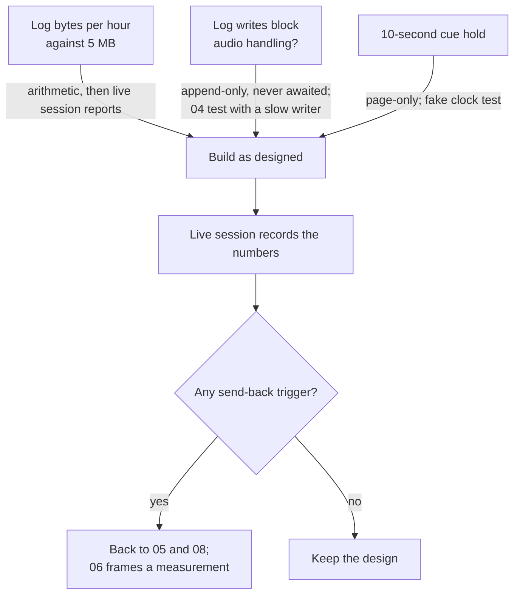

# SPRINT-004: no proof of concept before the build

SPRINT-004 (proposed, none active) adds a package upload, a local meeting log with Download log, and a new screen with keys G, L, S that hold the cue for 10 seconds. 00 Governance asked stage 06 whether any experiment must come first. **Decision: no.** Three uncertainties remain, each is settled by a test or by the live session, and none needs a bounded experiment of its own.

*Each uncertainty ends in an existing check, not a new experiment; the send-back triggers are listed below.*

## Basis

Read on 19 November 2026: plan v6 [03.14](../07-planning/03.14-sprint-004-working-plan.md) and [03.14.1](../07-planning/03.14.1-sprint-004-documents-and-decisions.md), the [report note](../07-planning/03.16.2-sprint-004-relationships-and-06-note.md), 05's [architecture review](../05-high-level-design-and-architecture/03.5-sprint-004-architecture-review.md), its [log design](../05-high-level-design-and-architecture/01.10-meeting-log-and-transcript-message.md) and 04's [review](../04-benchmarks-and-eval-strategy/03.12-sprint-004-evaluation-review.md). Nothing was run, no code opened beyond a search of the service for the current audit call, and no OpenAI request made. Hashes of those pages were not recomputed.

## The three uncertainties

| Uncertainty | Why no experiment | What settles it |
| --- | --- | --- |
| Log bytes per hour against 5 MB | The cap is provisional and the rate is unmeasured, but an hour of speech is roughly 150 words a minute, about 55 KB of plain text. Even if each event repeats its fields tenfold, an hour stays near 0.5 MB. This is arithmetic from assumptions, not a measurement; it holds only if partial transcripts are not logged per fragment. If they are, 08 (MS format) should say so | The live session reports the real bytes per hour (04's amendment). The cap only ends completeness with one `log_full` event; nothing breaks |
| Log writes must not block audio handling | A design property: one append-only writer that never reads, whose failure shows "log not saved" (05, ML-12). Today the audit is a synchronous console line, so the risk is new only if the writer awaits | 04 tests with a deliberately slow or failing writer, checking that packets keep flowing. 09 must not await a write on the audio path |
| The 10-second cue hold | Page-only; no service, network or model involved | 04's controllable-clock tests (PC4-43 to 46); 09 and 08 provide the clock |

## What would send the design back

Proposed by this stage for Pablo's agreement, since no limits exist:
- The live session shows more than about 2 MB of log per hour, so 5 MB would end a three-hour meeting short of complete. Then raise the cap or compact the format (05, 08), and 06 frames a measurement.
- A slow or failing log write delays packet handling or the cue in any test or live step. Then the writer moves off the audio path (a queue), a 09 and 05 change.
- A hold of 10 seconds cannot be made deterministic with the page clock. Then 08 changes the clock rule; no experiment.

## Amendment: the avatar draw loop (story B-15)

Added 19 November 2026 after [03.14.2](../07-planning/03.14.2-sprint-004-avatar-story.md), 05's [01.11](../05-high-level-design-and-architecture/01.11-avatar-adapter.md) and 08's [03.7.9](../08-low-level-design/03.7.9-s004-avatar.md). **No separate POC still holds.** A WebGL loop shares the main thread with the audio sends to the service and the cue timer, and nothing measures that cost yet. The design already contains the exit: about 15 fps, paused when hidden, a toggle and key A, and silent removal on failure. A wrong guess costs a switch-off, not a redesign, and a lab experiment would not reproduce Pablo's laptop with a real call.
**Smallest measurement, inside the live session, not before it:** run one stretch with the avatar on and one with it off. Record the longest gap between audio chunks arriving at the service (the service already counts packets; it needs arrival times), the draw counter `data-avatar-frames`, and whether Pablo sees the cue or timer stutter. No new billable call, no new tooling beyond that timing record, owned by 04 and 09.
**Send back if:** with the avatar on, an audio gap exceeds about 250 ms (a figure I propose; none exists), transcription visibly drops words, or the cue stutters. Then the default flips to off and 05 moves the draw loop off the main thread, or the story slips, as the plan already allows.

## Not for this sprint

Raising the 20,000-character limit for his 130 KB package needs a measured delay and cost; frame it for stage 06 in SPRINT-005. The delay of the one-call flow stays learned in the live session, as in the [SPRINT-003 decision](03.1-sprint-003-poc-decision.md).

## Status

Draft of 19 November 2026 by 06 POC. Starts no sprint, authorizes no experiment, no code and no `.asdg/` change, and records no acceptance. Return to the [POC index](README.md).
