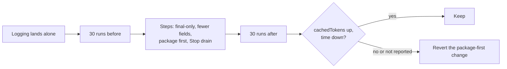

# SPRINT-005: no proof of concept before the build

SPRINT-005 (active, branch `sprint-05`) makes Alice answer faster: read final text only, drop unused fields, put the package first in the request, and drain buffered speech at Stop. **Decision: no stage 06 experiment.** One uncertainty remains and the sprint's own measurement decides it.

*The only uncertain step is built into the sprint as a measured, revertible change.*

## Basis

Read on 22 November 2026: 05's [architecture review](../05-high-level-design-and-architecture/03.6-sprint-005-architecture-review.md) and 04's [evaluation review](../04-benchmarks-and-eval-strategy/03.15-sprint-005-evaluation-review.md). Nothing was run, no OpenAI request made, no code opened. Source hashes not recomputed.

## Why no experiment

Final-only reading, dropped fields, call order and the Stop drain are deterministic: service and page tests settle them (04's ST5-1, ST5-2, ST5-8, ST5-9). 05 notes the Stop drain also needs a page change, so the page must not close the socket early; that is design, not an unknown. A lab experiment would duplicate the 30-run before and after measurement 04 already plans, on a synthetic input instead of Pablo's package.

## The one uncertainty, and what settles it

**Question:** does putting the package first make repeated prompt prefixes cache, so `cachedTokens` rises and the median time to bullets falls? Plausible, unverified: caching normally needs about a thousand tokens of identical prefix, so it can help only with a package of a few thousand characters or more. Settled by RT5-3 on the 30 after-runs, and reverted on no gain.

## What would send the design back

- The API or SDK reports no cached tokens: S005-SMALLER is unverified, not passed. 09 should confirm where usage is reported before the build.
- `cachedTokens` stays zero or the median is not 1.5 s lower: revert package-first; the other steps stand alone.
- `speech_lost` is not zero at a mid-sentence Stop: back to 05 and 08.

## Status

Draft of 22 November 2026 by 06 POC. Starts no experiment, edits no code or `.asdg/` file, records no acceptance. Return to the [POC index](README.md).
