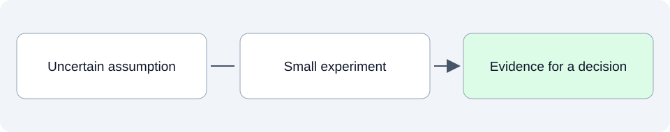

# Proof of concept: resolve a specific uncertainty

This folder will record small experiments that answer a concrete technical question before we invest in a larger implementation. Each experiment needs a question, a bounded setup, observations and a conclusion.

## SpeakerCoach today

No proof-of-concept experiment or result is documented in this stage yet. The existence of the speaking-duration prototype alone does not answer every question about future coaching capabilities.

## What belongs here as we develop

For example, an experiment might investigate whether a candidate approach can identify a question quickly enough for the intended interaction. That is an example of possible work, not a selected experiment or an established result.

## Explore

- Use the [evaluation strategy](../04-benchmarks-and-eval-strategy/README.md) to define convincing evidence and [architecture](../05-high-level-design-and-architecture/README.md) to identify assumptions worth testing.

Read files in order: **01 Intended**, **02 Current**, **03 Planned**. Additional topics use dotted numbers such as `01.1` or `03.2`; release and sprint plans identify their horizon in the filename and text.
See the [folder guide](../../../asdg/00-governance/docs/stage-layout.md) for consolidation at cycle closeout. Return to [project documentation](../README.md).
