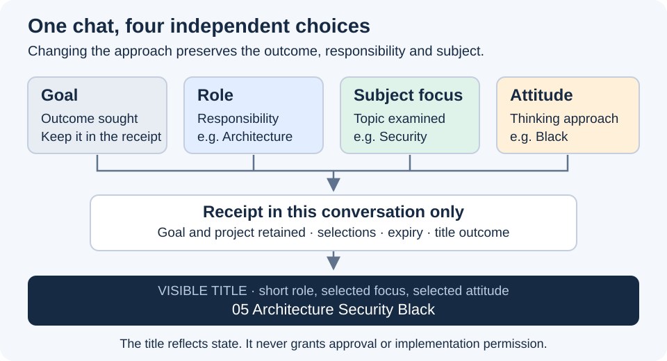

# Role, focus and attitude in a concise title

Pablo clarified the naming convention on 28 October 2026: the project suffix had been mistaken for focus.
Use **ID Name Focus Attitude**, separated by spaces, and omit focus or attitude when unset. The project remains bound to the chat but is absent from its title.

| Selected fields | Title |
| --- | --- |
| Governance only | `00 Governance` |
| Architecture only | `05 Architecture` |
| Architecture, Security | `05 Architecture Security` |
| Architecture, Security, Black | `05 Architecture Security Black` |

The [short-name mapping](../../../asdg/skills/asdg-focus/focus-choices.md) uses Pablo's exact thirteen labels, from Governance to Observability.
Canonical role IDs, responsibilities, source folders and legacy selection commands are unchanged. NoFocus/NoAttitude remain clear aliases and receipt values, with no title text for either.
Subject changes again update the title. Reading a role or renaming a chat never activates it or changes its scope.

## Evidence

All thirteen existing specialist/governance chats and both pilot chats were renamed through native tools; readback matched all fifteen requested names.
The pilot chats are now `05 Architecture Security` and `05 Architecture Performance`; their retained subjects and goals were preserved.
Structure verification, all thirteen label comparisons and whitespace checks pass. Package checks retain the same eight pre-existing external presentation-link failures.
The new SVG was rendered and inspected at 720 px. This instruction-only change adds no implementation test or new agent session.
Existing uncommitted work, application code, sprint state, hooks and historical review reports remain intact; no commit, push, peer message or role/attitude selection occurred.
This clarification supersedes the naming conventions in reviews 02.8 and 02.9; their observed results remain historical evidence.

[Naming contract](../../../asdg/skills/asdg-focus/rename-chat.md) · [Exact incremental diff](02.10-review-concise-role-titles.diff)
