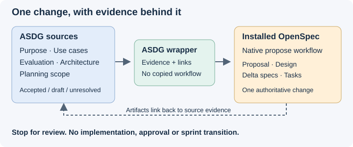

# An ASDG proposal, using the installed OpenSpec workflow

This increment adds **ASDG openspec propose**: one thin wrapper that reads the project's evidence, uses the installed native workflow and links the resulting change back to its sources. It creates no real SpeakerCoach proposal yet.

The canonical [skill](../../../asdg/skills/asdg-openspec-propose/SKILL.md) and [evidence contract](../../../asdg/skills/asdg-openspec-propose/evidence.md) preserve existing command meanings. `asdg-prepare-plan`, `asdg-propose-architecture` and `openspec-propose` are unchanged. This adds a skill, not a terminal subcommand.

## Discovery and scope

Codex's live skill catalogue exposed all six installed OpenSpec skills: propose, explore, update-change, apply-change, sync-specs and archive-change. Their discovery was observed independently of reading `SKILL.md`; the full installed propose instructions were then read.
OpenSpec CLI 1.15.0 resolved this client and reported no changes. Native discovery of the newly added ASDG wrapper in a fresh picker remains unverified; its adapter is installed and structurally verified.
The current chat selected subject **OpenSpec integration**, preserving Governance and NoAttitude; native title readback matched `00 Governance OpenSpec integration`.
Starting revision: `c7b911964f0c558849f17ab0edaec8aa89adeeec`. The native OpenSpec installation and `openspec/` were already untracked; they are preserved and excluded from this increment's diff.

## What changed

- Canonical wrapper, evidence/traceability contract, bounded verification cases and explanatory SVG under `asdg/skills/asdg-openspec-propose/`.
- Thin adapter and UI metadata in both `asdg/templates/.agents/skills/asdg-openspec-propose/` and the installed `.agents/skills/asdg-openspec-propose/`.
- Shared skill index; one relocation/preservation regression and its Markdown companions; this report/index and exact-hash AI modification receipts.

The wrapper reads Purpose, Use Cases, Evaluation, Architecture and current Planning/state. It distinguishes current acceptance, stale approval, drafts and stakeholder direction, then follows the installed schema and paths. Source hashes/links live in the change; ASDG sources and OpenSpec artifacts are not mirrored.

## Evidence and limits

| Check | Observed result |
| --- | --- |
| ASDG structure | `python3 asdg/scripts/cli.py verify` passes. |
| Regression suite | `TMPDIR=/private/tmp python3 -B -m unittest discover -s asdg/tests -p 'test_*.py'`: 59 passed on Python 3.15.0. |
| Initial test run | Two path-comparison failures under macOS `/var` versus `/private/var`; the new test normalizes its expected path, and the documented TMPDIR fixes the existing test environment. |
| Native CLI smoke test | A disposable fixture produced proposal, delta spec, design and tasks; 4/4 complete and strict validation passed with zero issues. |
| Fixture traceability | Ten links resolve; five draft source hashes match; 424 pre-existing fixture files remained byte-identical. No accepted decisions were fabricated. |
| Real project preservation | Initial 45-path snapshot unchanged before appending documentation receipts; upstream skills, application, hooks and lifecycle/sprint state remain unchanged. |
| Package check | Eight existing external presentation-link errors in unchanged `asdg/README.md`; no new errors. |
| Other checks | Whitespace and source-line limits pass. Generic skill validator unavailable because PyYAML is absent; no dependency installed. |

The smoke test exercises the installed CLI, schema and provenance format; it is self-authored integration evidence, not an independent agent test of every instruction. Separate stores, collisions, denied writes, missing-native-skill handling and a fresh wrapper invocation remain unexercised.
The wrapper/evidence pages and this report embed the new SVG, inspected at 720 px; the test companion's existing diagram was also inspected. These were asset rendering checks, not full Markdown preview checks. Fixture Mermaid rendering was not checked.

## First real proposal

Use the invocation in the [validation receipt](02.11-review-openspec-proposal-wrapper.json). It targets UC-04 as possible next-sprint work and asks for material conflicts before drafting.
Current status marks Evaluation and Architecture accepted, but Purpose and Use Cases stale. UC-04 proposes explicit confirmation while the accepted architecture describes evidence-driven promotion; Purpose also requires distinguishing both speakers while UC-04 allows Pablo-only input. These are review decisions, not choices this wrapper makes silently.
SPRINT-000 remains the existing streaming/agent POC. No application implementation, actual feature proposal, approval, sprint transition, commit or push occurred.

[Exact increment diff](02.11-review-openspec-proposal-wrapper.diff) · [Validation receipt and changed paths](02.11-review-openspec-proposal-wrapper.json)
