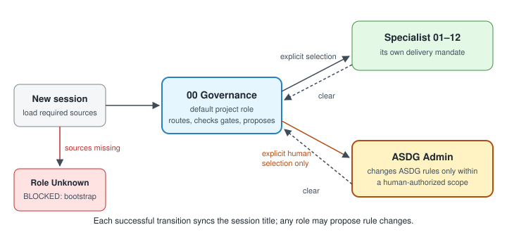

# Governance by default, a separate ASDG Admin, and titles that follow the role

Every session on an ASDG project now has an accountable role. 00 Governance operates the project by default; a new **ASDG Admin** role is the only role under which an agent may change ASDG's own rules.
The session title now follows each successful role change. This record covers two requests made on 30 October 2026.

## Who asked, who acted

Requested by Pablo (repository owner) in the Claude desktop Code tab session `local_15c31fc2-e853-4e10-8d69-f4417296d9cf`, using wording reviewed by ChatGPT as methodology reviewer.
Acting agent: Claude (Opus 5.5) in that session. Starting revision `6c79992`; earlier uncommitted work in the tree is listed in the [receipt](02.12-review-governance-admin-and-titles.json).

1. **Default-session governance.** Performed under the then-current rules, which allowed no-role maintenance; the agent declared "Role: None" at that time.
2. **Bootstrap of Admin.** Authorized explicitly by the second request. Performed under 00 Governance: Admin's entry, contract, registration and procedure were written, and Focus learned to resolve it. Admin did not exist before this.
3. **Admin activation.** Pablo instructed "YOU SHOULD BECOME ASDG ADMIN". All required sources were read; the title changed to `ASDG Admin` (RENAMED, readback matched). Every later change in this record was made under Admin.

## What changed

- **Default role:** a new session reads the entry points and coordinator sources and starts as 00 Governance; clearing returns there; a missing source records role Unknown and blocks dependent work. The default gains no specialist authority.
- **ASDG Admin:** [entry](../../../asdg/admin/AGENTS.md), [contract](../../../asdg/admin/types/contract.md), [procedure](../../../asdg/admin/skills/maintain-rules/SKILL.md) and [registration](../../../asdg/admin/types/admin-role.json). Explicit human selection only; selection authorizes nothing; never self-selected to escape a restriction.
- **Maintenance allowances replaced** in all twelve specialist entries, the coordinator, `asdg/AGENTS.md`, the review loop and documentation authority.
- **Title sync:** new-session start, legacy None migration, clear to Governance and any explicit role, subject or attitude change. Claude's `set_session_title` is documented beside the Codex actions.
- **Checks:** `status` reports `session_governance`; the generated root bridge states both rules; repeat setup upgrades either earlier bridge with a backup.

## Decision for review

Admin is registered in its own package rather than the lifecycle catalogue. The catalogue is validated as exactly 13 roles and its hash is bound in `.asdg/project.json`; changing it would need a project-state upgrade nobody authorized.

## Evidence

| Kind | Result |
| --- | --- |
| Automated | 67 tests passed on 30 October, 70 after the follow-up below, with `TMPDIR=/private/tmp`; `verify` passes; link check adds no new errors. |
| Automated, role-agnostic | With an active sprint, the guard denies a patch to an ASDG rule and `asdg/` cannot be sprint scope. |
| Automated, text only | Instructions contain the new rules and none of the old role-None or maintainer allowances; the check caught all four old phrasings in the committed files. |
| Observed in Claude | `set_session_title` renamed this session twice, with matching readback. |
| Native scenarios | Run on 31 October in disposable fixtures (below); real resume and compaction still not run. [TRY-IT](../../../asdg/skills/asdg-focus/TRY-IT.md) lists them. |
| Codex | Three ephemeral `codex exec` runs on 31 October (below); no title rename tool was available. |

## Follow-up fixes, 31 October 2026 (under ASDG Admin)

Pablo authorized two bounded corrections. The guard now checks the governance bootstrap before every write, documentation included; documentation still needs no sprint, and read-only commands stay available. Package preflight and `verify` now validate the Admin registration and sources, without touching the catalogue or binding.
70 automated tests pass. Native runs used disposable fixture copies; [scenario log](02.12-review-governance-admin-and-titles.json).

| Scenario | Claude desktop (fresh sessions) | Codex CLI 0.162.1 (`exec --ephemeral`) |
| --- | --- | --- |
| New session | Governance; titled `00 Governance` (readback) | Governance; title computed, no rename tool |
| Select 05, then clear | `05 Architecture`, then `00 Governance` | Not run |
| Explicit Admin | `ASDG Admin`; no rule changed | Not run |
| Legacy None (pasted receipt, simulated) | Migrated; titled `00 Governance` | Not run |
| Rule edit without Admin | Refused, did not self-select; **title not synced** | Refused, did not self-select; asked for Admin |
| Missing coordinator contract | Role Unknown, BLOCKED, no write | Role Unknown, BLOCKED, no write |

In both bootstrap runs the agent refused before any write, so the guard hook was not exercised natively. Real resume and compaction were not run.

## Enforcement gaps

A role label does not protect filesystem writes. Role state lives only in the conversation, and no hook checks it.
The Codex guard blocks agent patches under `asdg/` for every role, Admin included, when its hooks are trusted; that trust is unverified. In Claude Code nothing blocks these writes.
Nothing automated stops an agent from claiming Admin; the defence is the instruction plus human review of the diff.

Open question: rename-chat shows `Role unknown` for a blocked role, but the policy syncs titles only after sources load; both Claude and Codex left the title unchanged.

**Review status:** proposal awaiting Pablo's review. Nothing committed, approved or pushed.
