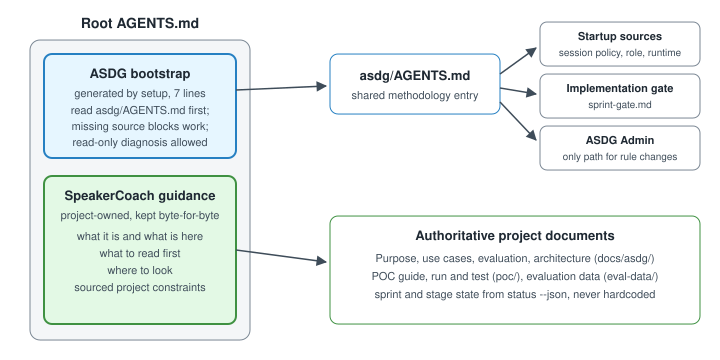

# Root AGENTS.md: a small ASDG bootstrap, then SpeakerCoach guidance

The root `AGENTS.md` used to be almost entirely ASDG policy and said little about SpeakerCoach. It now opens with a seven-line, setup-generated bootstrap that requires `asdg/AGENTS.md` and its startup sources. Everything after that block is project-owned guidance.

## Who asked, who acted

Requested by Pablo on 31 October 2026, in the Claude desktop session `local_15c31fc2-e853-4e10-8d69-f4417296d9cf`; acting agent Claude (Opus 5.5). Starting revision `675df99`, with a clean tree.
**ASDG Admin**, explicitly re-selected; sources reloaded; the title already matched, so no rename. Admin changed the methodology, the generated bootstrap and its validation, and ran setup.
**00 Governance**, an explicitly authorized switch; sources loaded; title synced to `00 Governance` with matching readback. Governance wrote the project-owned section and this record.

## Where the removed root rules live

| Rule from the old root block | Authoritative home, reached through `asdg/AGENTS.md` |
| --- | --- |
| Read the session policy every turn; default Governance; Focus is per conversation; reading never activates a role | `asdg/AGENTS.md` startup sources; session policy |
| Run `status --json` before substantial work, using the local entry point; `verify` is structural only | `asdg/AGENTS.md` startup sources |
| Evidence in `docs/asdg/`; preserve `.asdg/` state and review history; logs are disposable | `asdg/AGENTS.md` client work |
| Check every target; no sprint means blocked; human start and stop only; scope rules; scoped `apply_patch`; no arbitrary shell writes | `asdg/AGENTS.md` implementation gate, sprint gate, runtime contract |
| No state, hook or policy edits as implementation; a sprint never widens authority; hooks need trust | `asdg/AGENTS.md` implementation gate, sprint gate |
| Agent rule changes only under ASDG Admin | `asdg/AGENTS.md` maintenance; Admin entry |
| Documentation authority; ASDG Approve and sprint-utility limits; installation grants nothing | `asdg/AGENTS.md`, documentation authority, runtime contract |

Before removal, a test confirmed each rule's text at its new home and that `asdg/AGENTS.md` links every startup source.
Four rules were missing from that sequence and were added: status timing, the local entry point, verify being structural only, and installation granting nothing.
The sprint gate now states that scope bounds paths only and the work must still meet the objective and acceptance criteria.

## Generator and checks

`merge_bootstrap` puts the block first and keeps all other text byte-for-byte. The three exact earlier blocks, which older setups appended at the end, move to the top with a backup; edited, moved or duplicated blocks conflict without writing.
`verify` now requires the current block first and only once. The bootstrap check counts an `asdg/AGENTS.md` link only inside a managed block, current or legacy.
Leftovers fixed: the role explainer still described a role-less mode, the runtime contract let maintenance follow root instructions instead of Admin, and the sprint gate referred to an implementation gate in `AGENTS.md`.

## Evidence

| Kind | Result |
| --- | --- |
| Automated | 73 tests pass, including legacy upgrades, byte-for-byte preservation, idempotent setup, conflicts, bootstrap blocking, documentation without a sprint and Admin validation. |
| Automated, against real files | All three legacy blocks equal this repository's earlier root file and its two setup backups byte-for-byte. |
| This repository | Setup moved the block and wrote a backup and receipt; repeat setup planned no changes; `verify` and `status` pass. |
| Observed in Codex | One ephemeral, read-only `codex exec` (CLI 0.162.1) in a fresh copy followed the bootstrap: it read `asdg/AGENTS.md` and the full Governance startup sequence, declared 00 Governance, took sprint state from `status --json` and used the project section; no files changed. Not observed in a new Claude session. |

## Limitations

Startup behavior is instructional. No hook checks that an agent read `asdg/AGENTS.md` or follows the project section.
The Codex guard treats every root `AGENTS.md` edit as protected, so agents there cannot edit the project-owned section; a human can.
A legacy project text without a final newline gains one when its block moves, because the old separator is ambiguous.
Codex noticed that `docs/asdg/00-governance/README.md` still says no sprint is active, a stale dated note outside this change.

**Review status:** proposal awaiting Pablo's review. Nothing committed, approved or pushed.
