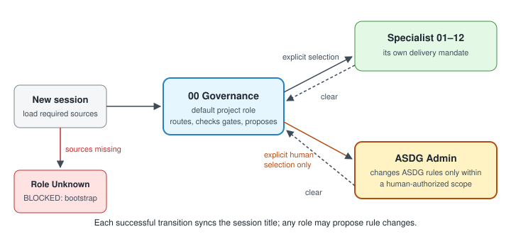

# `$asdg-admin`: an explicit skill for switching to ASDG Admin

Until now, ASDG Admin could be selected only through `$asdg-focus admin` or plain words such as "switch to ASDG Admin". A dedicated `$asdg-admin` skill now does it, in the same way `$asdg-role` and `$asdg-attitude` serve their purposes, and `$asdg-admin clear` returns the chat to 00 Governance.

## Who asked, who acted

Requested by Pablo on 31 October 2026: "we need a skill like the other to tell the session that is a asdg admin. in the same way we have asdg role".
Asked to select the role, Pablo answered "Switch to ASDG Admin". Claude (Opus 5.5) in session `local_15c31fc2-e853-4e10-8d69-f4417296d9cf` loaded the ten Admin sources and synced the title from `00 Governance` to `ASDG Admin`, with matching readback.
Starting revision `675df99`; the uncommitted root-bootstrap change from [02.13](02.13-review-root-agents-bootstrap.md) was preserved untouched.

## What changed

- **Canonical skill:** [asdg-admin](../../../asdg/skills/asdg-admin/SKILL.md) acts only on explicit human invocation and loads every source the Admin entry lists. If one is missing, it keeps the previous role and title. It preserves subject, attitude and goal, syncs the title and states that selection authorizes no change. `clear` returns to 00 Governance. [Scenarios](../../../asdg/skills/asdg-admin/TRY-IT.md) list the expected behavior.
- **Codex adapter:** its template sets `allow_implicit_invocation: false`, as `asdg-focus` does; setup installed it in `.agents/skills/asdg-admin/`.
- **Admin entry:** it names the skill. Its load list now also includes session fields, the runtime contract and the response envelope, which `asdg/AGENTS.md` already requires of every selected role. The skill points to that list instead of copying it.
- **Registration and references:** the selector `$asdg-admin` was added; Focus choices, `asdg/AGENTS.md` and the skills index mention the skill.
- **Leftover fixed:** the skills index still said "governance remains distinct from no focus"; it now names 00 Governance as the default.

The registration keeps `native_adapter: null`: that field means a named delegated agent such as `.codex/agents/*.toml`, which Admin still does not have.

## Evidence

| Kind | Result |
| --- | --- |
| Automated | 74 tests pass, including installation, relocation, implicit invocation off, link resolution and idempotent setup; `verify` passes. |
| This repository | Setup installed the two adapter files and a receipt; repeat setup plans no changes. |
| Observed in Codex | Two ephemeral `codex exec` runs (CLI 0.162.1) in a fresh copy. `$asdg-admin` then `clear`: Codex used the skill, read every source the Admin entry lists, became `ASDG-ADMIN` and then 00 Governance, and proposed the titles `ASDG Admin` and `00 Governance`; `exec` has no rename tool. A rule-edit request without Admin: Codex stayed in 00 Governance, made no change and asked the human to reply `$asdg-admin`. No files changed in either run. |
| Not observed | Claude: ASDG skills have no Claude adapters (`.claude/skills/` does not exist), so a Claude session follows `$asdg-admin` only after reading the instructions. The Codex app's picker was not inspected. |

## Limitations

Role state is conversational; a role label does not protect filesystem writes.
`allow_implicit_invocation: false` is a Codex adapter policy; other clients rely on the instructions alone.

**Review status:** proposal awaiting Pablo's review. Nothing committed, approved or pushed.
