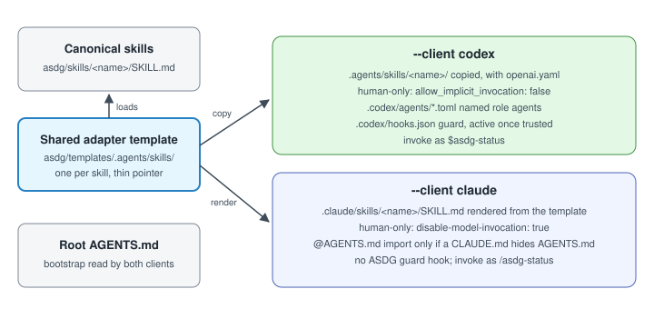

# Client-aware initialization: Codex, Claude or both

Setup now installs only the integrations a developer chooses, Codex, Claude Code or both, while every client loads the same canonical ASDG files. Adding a client later never touches the other, and repeat setup creates nothing that already exists.

## Who asked, who acted

Requested by Pablo on 31 October 2026, explicitly selecting ASDG Admin; he added that setup must be idempotent and must never recreate or duplicate what exists.
Claude (Opus 5.5) acted in session `local_15c31fc2-e853-4e10-8d69-f4417296d9cf` as ASDG Admin: sources reloaded, title already `ASDG Admin`. Starting revision `675df99`; the uncommitted 02.13 and 02.14 work was preserved.

## Commands and decisions for review

`python3 asdg/scripts/init.py --client codex|claude|both`, or `cli.py init` with the same options. Bare setup repeats the recorded clients, Codex when none, so it never adds Codex to a Claude-only project. An unknown client is rejected before writing.
The authoritative contract is [client integrations](../../../asdg/docs/client-integrations.md). Decisions to review:

- **One adapter source:** each Codex template is copied for Codex, and the Claude adapter at `.claude/skills/<name>/SKILL.md` is rendered from it, so no second copy is maintained.
- **Invocation:** skills that Codex keeps human-only get `disable-model-invocation: true` in Claude: Admin, Focus, Init, Status and Documentation.
- **Tracking:** `.asdg/integrations.json` records each client and its source, leaving the binding and state untouched. A legacy install is recorded explicitly, with a note.
- **Instructions:** Claude reads `AGENTS.md` natively from 2.1.277. A managed `@AGENTS.md` import is added only when a `CLAUDE.md`, `.claude/CLAUDE.md` or `CLAUDE.local.md` would hide it, and never duplicated.
- **Not installed for Claude:** named role agents and guard hooks.

Facts come from the official [memory](https://code.claude.com/docs/en/memory) and [skills](https://code.claude.com/docs/en/skills) pages, read 31 October 2026, and the installed Claude Code 2.1.309, bundled with the desktop app.

## Applied to SpeakerCoach

On Pablo's request, "Add Claude integration", `python3 asdg/scripts/init.py --client claude` added the 16 Claude adapters and `.asdg/integrations.json`, recording Codex explicitly as a legacy installation. No `CLAUDE.md` was needed.
All 58 Codex files, the root `AGENTS.md` and project state stayed byte-identical, and both clients verify `COMPLETE`. Repeat setup with no option, `--client claude`, `codex` or `both` plans nothing, and two real repeat runs left the tree unchanged.
The ledger keeps two older duplicate receipts from 20 and 23 October as history; setup added none. In a new SpeakerCoach session, Pablo then saw the ASDG commands in the desktop slash menu.

## Evidence

| Kind | Result |
| --- | --- |
| Automated | 83 tests pass, including 9 new client cases: fresh single and combined setups, either order, idempotence, dry run, invalid client, conflicts, shared canonical skills after relocation, invocation mapping, legacy records and the bridge. |
| Fresh fixtures | A Claude-only setup created only `.claude/skills/` (16 adapters); a combined setup created both; both verified. |
| Codex CLI 0.162.1 | In the combined fixture, `$asdg-admin` then `clear`: Admin, then 00 Governance; titles proposed only; no files changed. |
| Claude desktop 2.1.309 | Fresh sessions: `AGENTS.md` loaded natively; 11 ASDG skills listed, with the 5 human-only skills hidden from the model; a rule-edit request refused without self-selecting Admin, titled `00 Governance`, file unchanged. |
| Claude desktop, Admin | `/asdg-admin` arrived as a message from this session, not through Claude's slash handling; the agent followed the skill, titled itself `ASDG Admin` and changed nothing. |
| Claude desktop slash menu | Observed by Pablo in SpeakerCoach: typing `/as` listed the ASDG commands, including the human-only `asdg-admin`, `asdg-focus`, `asdg-status` and `asdg-init`, marked `(project)`; the tooltip matched the installed adapter's description. |
| Not observed | Invoking `/asdg-admin` natively through the menu; every Claude CLI check, because the bundled CLI is not logged in. |

## Limitations

Role and Admin rules remain instructions in both clients; Claude has no ASDG guard.
A chat that another session starts with `/asdg-admin` follows it like a human request; the tested agent flagged that the request was relayed.
The Create team and Development view descriptions still mention Codex in both adapters, and both skills depend on Codex capabilities.

**Review status:** proposal awaiting Pablo's review. Nothing committed, approved or pushed.
