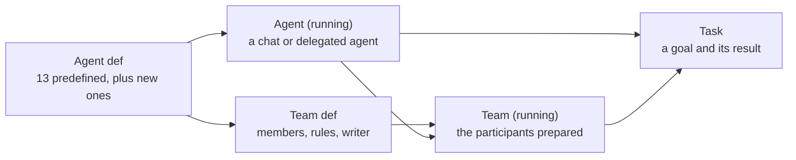

# Agent defs, team defs and their use: implementation plan

Status: proposed on 2026-11-16 by Claude as ASDG Admin, at Pablo's request, for Codex to review. Nothing here is implemented or approved.
Scope: Alice's embedded `asdg/` copy, starting from commit `8192a1f`. Promotion to the canonical repository is a later, separate step.

Pablo wants a small, consistent set of skills for finding, defining and using agents and teams. The governing idea is his: **a definition is one thing, its use is another**. The same split applies to one agent and to a team.

*A def describes. A running agent or team participates. A task gives it work. Saving a def prepares nobody, and preparing participants assigns no work.*

## Concepts and what exists today

| Concept | Meaning | In Alice today |
| --- | --- | --- |
| Agent def | Reusable description: purpose, role, owned folder, boundaries | 13 predefined in the [catalogue](../../../asdg/00-governance/types/agent-catalog.json); `cli.py agent list` and `describe` |
| Agent (running) | One chat or delegated agent acting as a def | Only each chat's own role selection; no list |
| Team def | Purpose, member slots naming agent defs, rules | [Model](../../../asdg/scripts/lib/cli_team_model.md) and [store](../../../asdg/scripts/lib/cli_team_store.md), tested; no command |
| Team (running) | The participants actually prepared for a team def | Nothing recorded |
| Task | A goal and expected result given to an agent or team | [Run claim](../../../asdg/scripts/lib/cli_team_claim.md), tested; no command |

Predefined agents are agent defs. They appear in the same list as any new def; there is no second registry.
Focus and attitude stay with the conversation, as the [session policy](../../../asdg/skills/asdg-focus/session-policy.md) requires. A def stores neither in this plan.
Membership grants no authority. Each member writes only where its own agent def may.

## The writer rule

Every agent def owns one folder: it reads anywhere and writes only there, as [documentation authority](../../../asdg/00-governance/docs/documentation-authority.md) states.
Members with different defs therefore cannot collide. A team may also hold two members of the same def, and then both may write the same folder.

**Rule:** when two or more members own the same folder, or one folder nested in another, exactly one of them is marked writer for it. The others analyse and send proposed changes to the writer.

Saving a team def that breaks the rule is refused, naming the members that need a choice.
This is a recorded agreement. The [ownership check](../../../asdg/scripts/lib/cli_ownership.md) knows only an agent's def, so it cannot yet stop the second member; every result must say so.

## Skills

| Action | Agent | Team |
| --- | --- | --- |
| Define | `asdg-agent-define` | `asdg-team-define` |
| List and show defs | `asdg-agent-definitions-list` | `asdg-team-definitions-list` |
| Prepare participants | `asdg-agent-create` | `asdg-team-create` |
| Give a task | `asdg-agent-run` | `asdg-team-run` |

These are the names in Pablo's proposal. Skills gather intent; every stored change goes through the CLI's preview, exact token and apply, as [team workflows](../../../asdg/00-governance/docs/team-workflows.md) already require.
Two of the names collide with earlier decisions. The [decisions page](02.18.2-plan-agent-team-decisions.md) lists them and what this plan changes.
The [phases page](02.18.1-plan-agent-team-phases.md) gives the order of work and the evidence that ends each phase.
