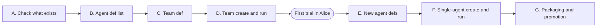

# Agent and team skills: phases and evidence

Part of the [implementation plan](02.18-plan-agent-team-skills.md). Seven bounded phases, built in Alice's embedded `asdg/` copy. Each ends with focused tests, Codex's review and Pablo's own word before any commit.

*Phases A to D deliver the first trial from Pablo's proposal: define one review team from existing agents, prepare it, give it one design question and inspect the result.*

| Phase | Delivers | Changes in `asdg/` | Ends when |
| --- | --- | --- | --- |
| A. Check what exists | A pass over the 19 installed skills and the CLI behind them | None | Pablo has exercised Focus, Attitude, Role and Status live, and the findings are listed |
| B. Agent def list | `asdg-agent-definitions-list`, with list and show, over the existing `cli.py agent` commands; the list gains purpose and owned folder | One new skill; `cli_model` output | The 13 predefined agents list unchanged; a snapshot test shows the view writes nothing |
| C. Team def | `cli.py team` with define, list and show; `asdg-team-define` and `asdg-team-definitions-list`; the writer mark and the same-or-nested-folder check | `cli_team_model`, `cli_team_store`, a new command module, two skills | "Alice Design Review" is saved; a team with two Architects is refused until one is the writer |
| D. Team create and run | `asdg-team-create` records the participants prepared; `asdg-team-run` gives one task under the run claim; status, stop and recovery. Sessions type only | `cli_team_claim`, the command module, two skills | The first trial runs in Alice, then a second task reuses the same team |
| E. New agent defs | `asdg-agent-define` under ASDG Admin: a def based on a predefined one, with a nested owned folder. First def: an AI Architect | Catalogue, `cli_model`, `cli_ownership`, Focus choices, package checks | `05-01` resolves, `01` still selects Context, and the list shows 14 defs |
| F. Single-agent create and run | `asdg-agent-create` and `asdg-agent-run` as thin entries over Focus and delegation | Two skills | Two Architect participants are prepared from one def and each takes one task |
| G. Packaging and promotion | Package list, manifest, index links, receipts, change record and the full suite; then a `cli.py promote` preview | Metadata and indexes | The integrity check passes and the promote preview shows no conflicts |

Subagents and Teammates team types, and any attempt at enforcing the writer rule, come after G and are not planned here.

## Dependencies outside `asdg/`

- **Client adapters.** A new skill needs its adapter under `.claude/skills/` and the Codex equivalent. Admin does not write those directly; they are regenerated from `asdg/templates/` through the existing update engine, with its own preview and Pablo's approval.
- **Local records of prepared participants.** Phase D proposes `.asdg/cache/teams/`, which the team policy already registers for per-checkout observations.
- **The run claim** lives in the Git common directory, as built. Tests use disposable projects; the first trial is the first real claim in Alice.

## What each kind of test shows

| Kind | Examples | Shows |
| --- | --- | --- |
| Configuration | Listing defs; saving and refusing team defs; stale tokens; second task refused while one is active | Stored state and its rules |
| Agreement | The writer rule; proposals sent to the writer | What the team def records, not what the system blocks |
| Native | The live skill checks in A; the first trial in D; two participants in F | Real behaviour in the client, with a tool trace for each handoff |

Already in place from the earlier chunks: 5 model, 16 store and 11 claim tests, which pass in Alice at `8192a1f`.
