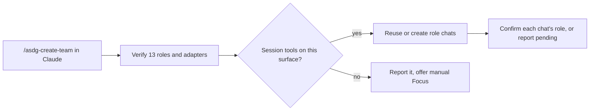

# Create team opens role chats in Claude again

Pablo asked on 16 November 2026 why `/asdg-create-team` no longer created chats in Claude, then asked for the skill to be fixed. This record covers that change and its first real run in Alice.

*The skill now creates role chats wherever the Claude surface can; manual Focus remains the fallback.*

## Why it stopped

Until 12 November the skill said nothing about Claude, so Claude followed its chat-creation steps with the tools it had.
From 13 November Alice carried a "Client mode" paragraph from the canonical 9 November baseline: "no native Claude chat automation is supported". That is true in a plain terminal and false in the desktop app.

## What changed

Claude acted as ASDG Admin in session `local_f340552a-28b4-4ef1-b4de-e7cfb25abb2e`, starting from `8192a1f`, with exact targets declared to `check-write`.

- [The skill](../../../asdg/skills/asdg-create-team/SKILL.md): Claude verifies the sources, then uses the same resolve, reuse and create steps where session tools exist.
- [Chat creation](../../../asdg/skills/asdg-create-team/create-chats.md): a new "In Claude" part with the same rules as Codex. A title never proves a role, and a started chat is not an activated role.
- [Initialization](../../../asdg/skills/asdg-create-team/initialization.md): an Init plan still includes no Claude chats; they need a direct request afterwards.
- [Client integrations](../../../asdg/docs/client-integrations.md), [installation](../../../asdg/docs/installation.md) and the [team plan companion](../../../asdg/scripts/lib/cli_team.md) now agree with it.

No Python changed. The Init engine still reports Claude as `native_chats: UNSUPPORTED`, which stays true for that engine.

## Evidence

| Kind | Result |
| --- | --- |
| Automated | `cli.py verify` passes; links in the six pages resolve |
| Automated | Suite of 196 tests: 19 fail, the same set as at `8192a1f` before this edit |
| Observed in the Claude desktop app | Thirteen role chats created in the Alice folder; each reported its role selected with all sources loaded, and each set its own title, `00 Governance` to `12 Observability` |
| Observed | No chat wrote a file; the working tree held only this change |
| Observed | The app accepted five started chats at once and refused the rest until they reported |

Exact hashes and session identifiers are in the [JSON record](02.19-review-create-team-claude-sessions.json).

## Limits and what is owed

- Observed once, on one surface. The Claude terminal fallback and reuse of existing chats were not exercised.
- Activation rests on each chat's own report and title; their conversations were not read.
- Sixteen of the failing tests come from the stale package list and manifest after the team files moved in; three were already failing before that move and are not investigated.
- The adapter description still says "for this Codex project". It is generated from the template and changes only through setup.
- Human review is pending; tests and a successful run are not approval.
