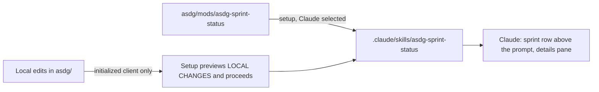

# Sprint status mod shipped with ASDG

Pablo asked on 16 November 2026 for the sprint status to stay visible in Claude's interface, chose "Ship the mod inside asdg/ and let setup generate it per project", then selected ASDG Admin and said "try again now you should have asdg admin rights". This record covers that change in Alice's embedded `asdg/`.

*Setup installs the mod; an initialized project with local methodology edits can now run setup.*

## What changed

Claude acted as ASDG Admin in session `local_f340552a-28b4-4ef1-b4de-e7cfb25abb2e` on branch `sprint-03` at `7d60c0f`, with exact targets declared to `check-write`.

- [The mod](../../../asdg/mods/asdg-sprint-status/hooks/register.md) reads `.asdg/sprint.json` and `.git/HEAD` and draws a row and a pane. It writes nothing. [Mods guide](../../../asdg/mods/README.md).
- [`cli_clients`](../../../asdg/scripts/lib/cli_clients.md) plans a mod's four runtime files for Claude, managed like skill adapters.
- [`cli_sync_manifest`](../../../asdg/scripts/lib/cli_sync_manifest.md) accepts `mods` as a package area.
- The package list gains the mod, its tests and the thirteen team files that were moved in earlier but never listed.

## Rule changed on the owner's direction

Before, setup refused any `asdg/` that differed from its delivery manifest: "working-tree snapshots cannot be installed". Alice's copy carries authorized local edits, so setup could not run there at all.
Now a project that is already initialized, running setup on its own copy, gets a preview marked `LOCAL CHANGES` and proceeds; see [install](../../../asdg/scripts/lib/cli_install.md) and [source verification](../../../asdg/scripts/lib/cli_install_source.md).
A first install, a clone install and an invalid manifest are refused as before. The manifest and build record are never rewritten, which keeps the provenance rule in the review loop. The Update skill's sentence on this was reconciled.

## Evidence

| Kind | Result |
| --- | --- |
| Automated | `check.py`: pass; it failed with four missing links before the package list was completed |
| Automated | [New setup tests](../../../asdg/tests/test_claude_mods.md): 6 pass |
| Automated | Suite: 202 tests, 3 failures, 5 skipped; it was 196 with 3 failures and 16 errors |
| Automated | `claude plugin validate` passes with warnings; `claude plugin test`: 3 pass |
| Observed in the Claude desktop app | Row and pane drawn from the real sprint record, with the mod loaded from a session mods folder |
| Applied in Alice | After Pablo's APPROVE of the displayed plan, setup added exactly four files under `.claude/skills/asdg-sprint-status/`, identical to the source; a repeat preview plans nothing |
| Automated | `cli.py verify`: Codex and Claude `COMPLETE`; manifest and build record unchanged |
| Observed | `claude plugin list` in Alice shows `asdg-sprint-status@skills-dir`, project scope, loaded |
| Observed by Pablo in the Claude desktop app | After setup, the sprint row shows in a new session opened in Alice |

Hashes, the approved plan token and the failing tests are in the [JSON record](02.20-review-sprint-status-mod.json).

## Limits and what is owed

- Seen in one new session only. Sessions already open may need to be reopened; the pane and command were not checked there.
- The session's trial copy of the mod was deleted after setup, so only the project copy remains.
- The three failing tests predate this change: their fixture copies `metadata/build.json`, which never matches a resealed copy. Excluding that file from the fixture would fix them; it was outside this scope.
- The mod API is early access and may change with Claude Code releases.
- Methodology edits sit on the application sprint branch `sprint-03`; how to commit them is Pablo's decision.
- Human review is pending; tests and a preview are not approval.
