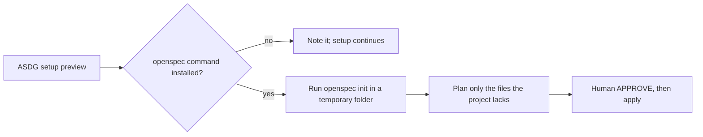

# Setup adds OpenSpec's project files

On 16 November 2026 the Claude side of Alice could not write an OpenSpec proposal: ASDG ships `/asdg-openspec-propose` for both clients, but OpenSpec's own skills had been installed for Codex only. Pablo asked "please make the asdg setup instakll openspec" and selected ASDG Admin with "Switch to Admin". This record covers that change in Alice's embedded `asdg/`.

*OpenSpec's files join the plan the human already approves; nothing existing is overwritten.*

## What changed

Claude acted as ASDG Admin in session `local_f340552a-28b4-4ef1-b4de-e7cfb25abb2e` on branch `sprint-03` at `7d60c0f`, on top of the uncommitted change in [02.20](02.20-review-sprint-status-mod.md), with exact targets declared to `check-write`.

- [`cli_openspec`](../../../asdg/scripts/lib/cli_openspec.md), new: runs the installed `openspec` command in a temporary folder and returns the files the project lacks.
- [`cli_install`](../../../asdg/scripts/lib/cli_install.md) plans them for the clients of that run as rows of kind `openspec`, and reports the outcome in a note.
- `init` gains `--no-openspec`; the environment variable `ASDG_OPENSPEC=0` also switches the step off.
- `verify` reports per selected client whether the native proposal skill is present, and prints a note only in a project that uses OpenSpec. It is information, never damage.
- Ten existing test modules set `ASDG_OPENSPEC=0`, so the suite does not depend on OpenSpec being installed. Their companions were not edited for this one line.

## Decisions taken in the design

- "Install OpenSpec" means its project files. ASDG still never downloads the `openspec` command; when it is absent, setup says so and continues.
- Add-only. A file that exists is left alone even when it differs, and is reported.
- A failing or misbehaving `openspec` never blocks ASDG setup.
- The preview now runs a third-party program, in a temporary folder, with its telemetry variables set to off. Whether OpenSpec honours them was not verified.

## Evidence

| Kind | Result |
| --- | --- |
| Automated | `check.py`: pass |
| Automated | [New tests](../../../asdg/tests/test_openspec_setup.md): 6 pass, using a stand-in command |
| Automated | Suite: 208 tests, 3 failures, 5 skipped; the same three failures as in 02.20 |
| Manual probe, OpenSpec 1.15.0 | `openspec init` in disposable folders needs no prompt and wrote identical bytes on two runs |
| Applied in Alice | After Pablo's APPROVE of the displayed plan, setup added exactly twelve files under `.claude/`, all from OpenSpec 1.15.0; Codex files and `openspec/config.yaml` already matched and were not touched |
| Automated | After apply: `verify` passes with both clients `COMPLETE` and OpenSpec skills `PRESENT` for both; a repeat preview plans nothing; manifest and build record unchanged |

Hashes and the failing tests are in the [JSON record](02.21-review-openspec-setup.json).

## Limits and what is owed

- Observed in the Claude desktop app: the Admin session listed `openspec-propose` and the `/opsx:` commands right after the apply. No session has run one yet, and chats already open may need reopening.
- The real `openspec` command is exercised only by hand; the tests use a stand-in.
- OpenSpec's files are listed in the plan by path and hash, without diffs.
- Setup's skills and installation pages for Init were not rewritten; the approval presentation shows the new rows as it shows any other.
- Human review is pending; tests and a preview are not approval.
