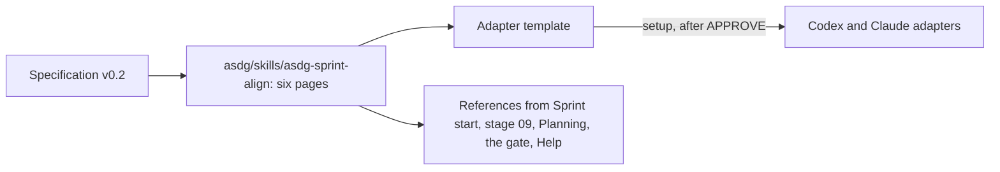

# Sprint align: a team skill for top-down consistency

On 16 November 2026 Pablo supplied the specification "Sprint Top-Down Consistency and Implementation Readiness" v0.2 and asked, while ASDG Admin was selected, to "implement `asdg-sprint-align` as a bounded ASDG Admin change", using the existing setup mechanism and the OpenSpec integration. This record covers that change in Alice's embedded `asdg/`.

*The rule lives in one place, the skill; other pages link to it.*

## What changed

Claude acted as ASDG Admin in session `local_f340552a-28b4-4ef1-b4de-e7cfb25abb2e` on branch `sprint-03` at `7d60c0f`, on top of the uncommitted changes in [02.20](02.20-review-sprint-status-mod.md) and [02.21](02.21-review-openspec-setup.md), with exact targets declared to `check-write`.

- [The skill](../../../asdg/skills/asdg-sprint-align/SKILL.md) states the rule, the owner, the six-step workflow and the limits.
- [Routing](../../../asdg/skills/asdg-sprint-align/routing.md): the parent coordinator owns the run; a specialist forwards; no invented channel.
- [Reviews](../../../asdg/skills/asdg-sprint-align/reviews.md): the first pass by 02 to 05 and the six relationships to reconcile.
- [Readiness](../../../asdg/skills/asdg-sprint-align/readiness.md): POC decision, plan, specifications, the readiness rule and freshness.
- [Report](../../../asdg/skills/asdg-sprint-align/report.md) and [scenarios](../../../asdg/skills/asdg-sprint-align/TRY-IT.md) A1 to A12 plus four routing cases.
- One adapter template, rendered for both clients; the model may invoke it.
- Links from Sprint start, the stage 09 procedure, the Planning procedure, the sprint gate, Help, the skill index and the usage page.

## Choices made while implementing

- No engine, guard or sprint-state change. Readiness stays an assessment; mechanical enforcement was left out, as the specification allows.
- Stage reviews are saved by each stage in its own folder; the report is Planning's, in the planning folder.
- A chat under Admin does not run an alignment; added as routing case R4.
- Where a surface has no way to reach other chats, one agent may do the reviews only on the human's explicit instruction and must report that independence was not achieved.

## Evidence

| Kind | Result |
| --- | --- |
| Automated | `check.py`: pass |
| Automated | [Structure tests](../../../asdg/tests/test_sprint_align_skill.md): 7 pass |
| Automated | Suite: 215 tests, 3 failures, 5 skipped; the same three older fixture failures as in 02.20 |
| Applied in Alice | After Pablo's APPROVE, setup added the three adapter files and appended two authorship receipts; `verify` passes; a repeat preview plans nothing; the sprint record is unchanged |
| Observed in the Claude desktop app | The Admin session's skill list gained `asdg-sprint-align` right after the apply |
| Observed, routing case R1 | Asked to run the skill, the 09 Coding chat ran no review and changed nothing; it forwarded to its parent, verified from its own session record, with project, sprint snapshot hash, reason and reply route |
| Observed, routing case R4 | The same chat noticed the parent's title read "ASDG Admin" and asked it to check its own role before starting |

Hashes are in the [JSON record](02.22-review-sprint-align-skill.json).

## Limits and what is owed

- Discovery and specialist forwarding were each observed once, in the Claude desktop app only. A full run is recorded by its own alignment report, not here; Codex was not tried.
- The tests check wording and links, not behavior.
- The source specification is a Google document outside this repository; its text is not copied here.
- Human review is pending; tests and a preview are not approval.
