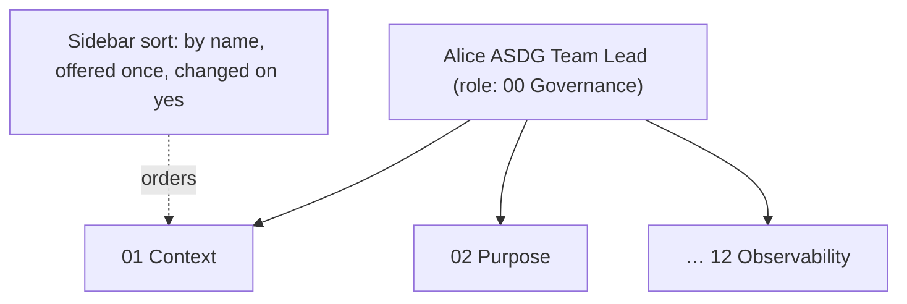

# Team lead title and name sort for Claude role teams

On 18 November 2026 Pablo, with ASDG Admin selected, looked at the Claude sidebar after Create team and said "the way it show now is perfect", "I like the name of the project instead of 00 governance", "we should hacve a more canonical name", and then fixed the pattern: "In general `<Project Nickname> ASDG Team Lead`". The Governance chat had relayed his earlier wish, "I need this sorting as default in asdg". This record covers that change in Alice's embedded `asdg/` only.

*Role chats sit under the chat that created them; sorting by name puts 01 to 12 in lifecycle order.*

## What changed

Claude acted as ASDG Admin in session `local_76b82554-3d13-429d-8123-87899d5c580b` on branch `sprint-03` at `bde3f7a`, with exact targets declared to `check-write`.

- [Title contract](../../../asdg/skills/asdg-focus/rename-chat.md#team-lead-title): a new section defines the team lead title; two older lines now name it as their exception.
- [Ordering](../../../asdg/skills/asdg-create-team/ordering.md#in-claude): a new Claude part offers one sort by name, skipped when already set, changed only on the user's yes.
- [Claude sessions](../../../asdg/skills/asdg-create-team/create-chats.md#in-claude): the line "Sidebar ordering stays a Codex step" now points to that part.
- [Session policy](../../../asdg/skills/asdg-focus/session-policy.md): one sentence names the team lead title as the only project-named title.

## Decisions this reverses

- Sidebar ordering was deliberately Codex-only; in Claude it is now an offered default. The approval gate stays, because the sort setting is shared by every project.
- The Governance chat's title was always `00 Governance`, and titles never carried a project name. The team lead chat is now the one exception. Its role is unchanged.
- The Governance chat's proposal to title it `00 Governance` so it sorts first was dropped: Pablo's screenshot shows the lead already sits above its role chats.

## Choices made while implementing

- Create team applies the title only to the calling chat; a title the user set is replaced only on their yes.
- The nickname comes from the user; it is asked for when unknown, never taken from the folder name.
- No engine, test, template or adapter change. The delivery manifest in `asdg/metadata/` was left as provenance, so the package now reports local changes.

## Evidence

| Kind | Result |
| --- | --- |
| Automated | `cli.py verify`: structure verified; `check.py`: pass |
| Automated | Suite: 215 tests, 3 failures, 6 skipped; the same three fixture failures recorded in [02.20](02.20-review-sprint-status-mod.md) |
| Observed in the Claude desktop app | Pablo's screenshot: twelve role chats listed 01 to 12 under the lead chat |
| Not run | Create team with the new text; the sort offer and the rename are untested |

Hashes are in the [JSON record](02.23-review-team-lead-title-and-name-sort.json).

## Limits and what is owed

- Local only: `/asdg-update` would overwrite these four files unless the change also lands in `Elustondo-ai/asdg`. No upstream proposal was drafted.
- The lead chat is still titled "Alice project in new folder"; renaming it is a separate request.
- Codex wording was not changed; the team lead title there is untested.
- Human review is pending; tests are not approval.
