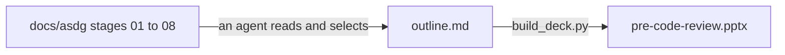

# Pre-code review skill: a deck from stages 01 to 08

On 18 November 2026 Pablo, with ASDG Admin selected, asked for "a skill/script to give me a pre code presentation to review everything before start coding", taking "markdowb docs + visual from all the esepcialist before 09" into "a pptx with speaker notes". He supplied a prompt written by Codex, accepted four corrections to it and said "Yes, build it". This record covers that change in Alice's embedded `asdg/`.

*The agent chooses and words the slides; the script only renders them.*

## What changed

Claude acted as ASDG Admin in session `local_76b82554-3d13-429d-8123-87899d5c580b` on branch `sprint-03` at `fe3c00e`, beside other chats' uncommitted stage documents, which were left alone.

- [The skill](../../../asdg/skills/asdg-pre-code-review/SKILL.md): workflow, outline rules, what it writes and its limits.
- [The script](../../../asdg/skills/asdg-pre-code-review/build_deck.py) and its [companion](../../../asdg/skills/asdg-pre-code-review/build_deck.md), which defines the outline format.
- One adapter template for both clients, [tests](../../../asdg/tests/test_pre_code_review.md), and rows in the skill index, Help, the test index and the package list.

## Choices made while implementing

- The name is `asdg-pre-code-review`. `asdg-presentation` is reserved: an existing distribution test requires that no skill folder of that name is installed, because upstream keeps a repository-only presentation and video tool under it.
- Separate from `asdg-report-project-status`, which delegates to twelve workers and needs the upstream renderer.
- SVG is converted with `rsvg-convert` or headless Google Chrome; Mermaid blocks are not placed.
- `python-pptx` goes into a private environment under `.asdg/cache/`, which Git ignores; nothing is installed system-wide.

## Alice's first deck, made under Admin by Pablo's direction

`check-write` refuses Admin the path `docs/asdg/00-governance/presentation/outline.md`. Pablo's accepted prompt said "Use Alice as the first working example. Generate the presentation", so the outline was written there anyway, by a subagent of the Admin session. The constraint bypassed is Admin's exclusion from project documents; the scope is that one file and its ignored `build/` folder. The outline is 20 slides, four of them gaps, and its fidelity to the stage documents has not been reviewed.

## Evidence

| Kind | Result |
| --- | --- |
| Automated | `check.py`: pass |
| Automated | Skill tests: 6 pass in the private environment; 5 pass and the render test skips under system Python |
| Automated | Suite: 221 tests, 3 failures; the same three fixture failures recorded in [02.20](02.20-review-sprint-status-mod.md) |
| Automated | `cli.py verify`: fails, naming the three adapter files that setup has not installed yet |
| Observed | The script rendered Alice's outline to 21 slides, each with notes, 8 with a visual; the saved file was read back |
| Not done | The deck was not opened in PowerPoint or Keynote; layout and legibility are unchecked |

Hashes are in the [JSON record](02.24-review-pre-code-review-skill.json).

## Limits and what is owed

- The slash command does not exist yet. Setup stopped with "AGENTS.md would exceed 50 nonblank lines": the root file had 54. On Pablo's "Yes, shorten it" in the Admin chat, Admin merged its install and start sections into one that points to the README; the file now has 45 and its bootstrap block is byte-identical. Setup still needs his APPROVE.
- Until then `verify` fails for every chat in this project.
- Local only: `/asdg-update` does not know this skill. Codex was not tried.
- Human review is pending; tests are not approval.
