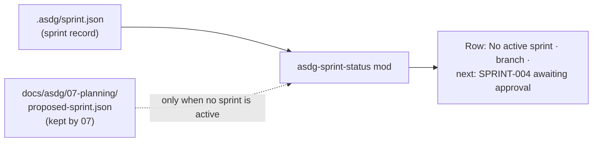

# Sprint status mod: show the proposed next sprint

Pablo asked on 19 November 2026, after SPRINT-003 closed, that the sprint-status mod say the project is between sprints and approving SPRINT-004, instead of only "No active sprint". ASDG Admin, explicitly selected in the 00 Governance chat, made this bounded change. It is a proposal for his review; nothing is committed.

*The mod stays read-only. The proposed-sprint file is shown only when the record is not active, and never replaces the record.*

## Request and scope

- **Request:** "change the asdg-sprint-status mod so that, when no sprint is active, it shows a proposed sprint and its approval state from a small file 07 Planning keeps. Show me the exact change before applying; no commit or push." He saw the diff and chose "Both: apply mod, then docs".
- **Owner override:** `.claude/skills/` is outside Admin's ownership and setup will not overwrite a changed file. Pablo answered "Yes, copy them" to copying the three runtime files there as his recorded owner override.
- **Out of scope:** making 07 Planning keep the file by duty (Admin backlog story A-01); the file itself, which 07 writes.

## Change

| File | Change | SHA-256 |
| --- | --- | --- |
| `asdg/mods/asdg-sprint-status/hooks/register.tsx` | Reads `proposed-sprint.json` when no sprint is active; row adds `· next: <id> <state>`; pane and widget show the next sprint | `a8101b903375` |
| `asdg/mods/asdg-sprint-status/types/index.d.ts` | New `NextSprint` type; `Sprint.next`; state tag `sprint-2` | `af482ff0fa1f` |
| `asdg/mods/asdg-sprint-status/.claude-plugin/plugin.json` | Version 0.2.0, description | `06e402628b33` |
| `asdg/mods/asdg-sprint-status/hooks/register.test.tsx` | Two tests: proposed sprint shown; hidden when a sprint is active | `0884de23b98f` |
| `register.md`, `register.test.md`, `types/index.d.md` | Companions updated | `a04bdc4dab85`, `844548ab2bc6`, `7560d731de23` |
| `.claude/skills/asdg-sprint-status/` (3 runtime files) | Copied unchanged from the source, owner override | same as source |

File fields: `sprint_id` (required), `state`, `objective`, `plan`, `previous`. A missing or unreadable file shows exactly what the mod showed before.

## Verification

- Automated: `python3 asdg/scripts/cli.py verify` reports "ASDG structure verified" after the copy; `tests.test_claude_mods` ran 6 tests, OK.
- Not run: `claude plugin validate` and `claude plugin test` (the `claude` command is not on this shell's path), so the two new mod tests have not been executed.
- Not observed: drawing in the desktop app. Pablo runs `/reload-plugins` and looks.

## Review status

REVIEW_REQUIRED. No approval inferred. No sprint state, hooks or approvals changed; no commit or push.
