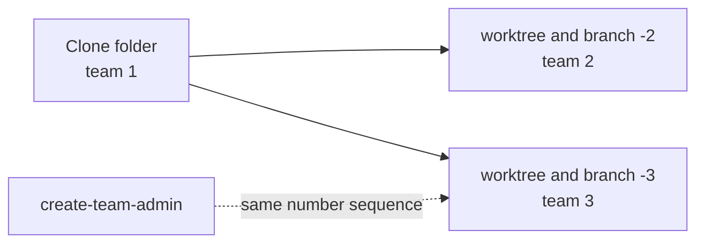

# Numbered teams: a worktree and a branch per team

On 20 November 2026 Pablo, with ASDG Admin selected, asked to "be able to create more than one team": when a team already exists, create team will "create a new one with a suffix of 2 [...] and it will create a worktree and a branch 2", plus a second command "very, very similar called ASDG Create Team Admin, which is going to be for changes in ASDG". On 22 November he said "can we implement this ASAP?". This record covers that change in Alice's embedded `asdg/`; the story is [Admin story 002](../../../asdg-admin-stories/002-more-than-one-team.md).

*One clone; each later team, project or admin, gets the next number, a worktree inside the clone and a branch.*

## What changed

Claude acted as ASDG Admin in the worktree `.claude/worktrees/sprint-04-2` on branch `sprint-04-2` at `ac01aaf`. Six uncommitted SPRINT-004 files copied there earlier were left alone.

- [Numbered teams](../../../asdg/skills/asdg-create-team/numbered-teams.md): the rule. Which request creates the next team, how the worktree is made, where chats start, the number in titles.
- [The script](../../../asdg/skills/asdg-create-team/team_worktree.py) and its [companion](../../../asdg/skills/asdg-create-team/team_worktree.md): plans or creates the next worktree and branch, and lists uncommitted files that are not carried.
- [Create team](../../../asdg/skills/asdg-create-team/SKILL.md) and [missing-chat creation](../../../asdg/skills/asdg-create-team/create-chats.md): a complete team is no longer reused; the next team is created in its own folder.
- [Create team admin](../../../asdg/skills/asdg-create-team-admin/SKILL.md), a new skill with one adapter template for both clients.
- [Title contract](../../../asdg/skills/asdg-focus/rename-chat.md): an optional team number after the role label.
- [Admin entry](../../../asdg/admin/AGENTS.md): Pablo's own create-team-admin request counts as the explicit Admin selection for the one chat it creates.
- [Tests](../../../asdg/tests/test_numbered_teams.md), and rows in the skill index, Help, the test index and the package list.

## Choices made while implementing, not yet confirmed by Pablo

- An admin team is one ASDG Admin chat, not a roster.
- The branch is `<stem>-<number>`, cut from the calling folder's current branch; `sprint-04-2` gives stem `sprint-04`.
- A new team starts from the last commit. Uncommitted files are listed and copied only on Pablo's yes.
- The last team is found from worktree folders and branch names; a number seen only in a chat title is passed to the script by the agent.
- The number sits after the role label: `05 Architecture 2`, `ASDG Admin 2`, `Alice ASDG Team Lead 2`.
- The Admin activation rule was widened by one sentence. No agent may select Admin on its own, as before.

## Evidence

| Kind | Result |
| --- | --- |
| Automated | `check.py`: pass |
| Automated | Numbered team tests: 7 pass, in disposable Git repositories |
| Automated | Suite: 228 tests, 3 failures; the same three fixture failures recorded in [02.20](02.20-review-sprint-status-mod.md) |
| Automated | `cli.py verify`: fails, naming the three adapter files that setup has not installed yet |
| Observed | The script, run in plan mode in this worktree, returned team 3, branch `sprint-04-3` |
| Not done | No team was created through either skill; chat start inside a worktree, titles and Admin activation are untested on any surface |

Hashes are in the [JSON record](02.26-review-numbered-teams.json).

## Limits and what is owed

`session-policy.md` and `ordering.md` were not changed. The `/asdg-create-team-admin` command appears only after setup installs its adapters, which needs Pablo's approval of the exact plan. Nothing is committed, and no upstream proposal exists for this change.
