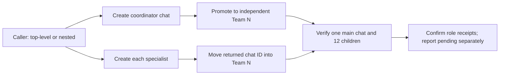

# A reusable Copilot team setup

The user requested `asdg-team-create2` on 26 November 2026: callable by a human or agent from a top-level or nested chat, producing a separate top-level team with twelve correctly named specialists.
ASDG Admin was explicitly selected for this bounded skill-authoring task. This creates the workflow, not another live team.

*The caller remains unchanged. Native IDs, rather than titles or a UI composer, determine each destination.*

## Scope and rationale

- [Canonical workflow](../../../asdg/skills/asdg-team-create2/SKILL.md), [session protocol](../../../asdg/skills/asdg-team-create2/session-protocol.md), [activation prompts](../../../asdg/skills/asdg-team-create2/activation.md) and [acceptance scenarios](../../../asdg/skills/asdg-team-create2/TRY-IT.md).
- One shared discovery template; agent invocation enabled. The user approved the exact plan and the existing generator installed both client adapters; verification and a no-change repeat preview pass.
- Narrow references in session policy and the runtime contract allow this setup utility without a human-only trigger; host permissions and project-action gates remain intact.
- Skill index, Help reference and package file list include the new workflow. The delivered manifest is retained, not refreshed to disguise local edits.
- No application edits, new teams, worktrees, branches, sprints, commits or pushes are part of this task.

The earlier sessions showed a real failure: setup instructions reached a different top-level chat, and checking only its children missed the intended coordinator's identity.
The repair moved all twelve existing chats by ID into the original Team 1 and verified their titles and destination.
The reusable protocol uses those observed native operations directly; it does not rely on a coordinator message to spawn the roster or use UI typing after a routing error.
Resumption uses the same run's IDs. Fresh invocations create the next numbered team without modifying earlier teams.

## Verification and review

Portable syntax, links and line limits pass; shared adapter rendering permits agent invocation for both configured clients.
The 290-test regression run found one Help-index failure (6 skipped): its name matcher excluded digits. The directly related fix and Help entry pass all 9 distribution tests; the full suite was not repeated.
Exact results, adapter-plan approval and file hashes are recorded in the [JSON receipt](02.27-review-team-create2.json).
The complete new workflow has not been executed: both top-level and nested-caller scenarios remain live acceptance work.
The Mermaid source describes the placement flow; rendered visual inspection has not been performed.
This is an author assessment, not independent review or human acceptance. Status: `REVIEW_REQUIRED`.
