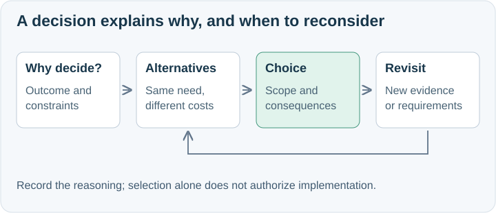

# Context-aware decision analysis and documentation

ASDG Decision turns a material choice into short visual explanations of its purpose, alternatives, consequences, and revisit conditions.
The user requested this methodology change after reviewing SpeakerCoach's OpenAI Agents SDK decision package.
The skill covers architecture patterns, boundaries, placement and ownership as well as product selection.

## What changed

[ASDG Decision](../../../asdg/skills/asdg-decision/SKILL.md) preserves the current project, specialist, discussion and explicit choices; analysis-only requests remain conversational.
[ASDG-05 foundations](../../../asdg/05-high-level-design-and-architecture/docs/architectural-decisions.md) require the method for material architectural decisions in assigned documentation.
The role's contract, native adapter, root instruction bridge and shared policies now agree on bounded decision-document authoring.
The [package format](../../../asdg/skills/asdg-decision/record-format.md) specifies a named folder, one or two introductions, meaningful option notes, editable visuals and evidence.
The [portable example](../../../asdg/skills/asdg-decision/example.md) teaches from SpeakerCoach without requiring its files, providers or number of products.
Canonical sources and thin discovery templates were added; the client adapter is installed without reinitializing project state.

## Validation evidence

Canonical and installed skills pass the skill-creator validator using an existing Python environment with PyYAML; no package installation was needed.
All 27 portable integration tests and all 3 agent-configuration tests pass, including a relocated client that preserves unregistered decisions and state on repeat setup.
The local structural verifier passes. The broader package checker reports eight existing external presentation links in unchanged `asdg/README.md`; changed paths have no reported issues.
New guidance, its diagram and updated source companions were rendered at a 720 px document-pane width; images load without horizontal overflow.
An independent ASDG-05 exercise created a non-product state-ownership package in a clean relocated client; protected state and application bytes were preserved.
A separate ASDG-07 analysis-only exercise used planning criteria and made no changes across 430 fixture files.
The authoring agent could not launch its page renderer; the parent completed embedded-page and diagram inspection with installed Chrome at 656 px image width.
Fresh-session skill-picker discovery and actual named-role/hook enforcement are not established by these source and fixture checks.

## Scope and review boundary

This is an explicit embedded-methodology update. It does not change application code, hooks, sprint/lifecycle/project state, or the prior architecture decision package.
The documentation allowance does not authorize implementation, deployment, or formal document acceptance.
The starting Git revision was `4952a131ed750b5428ce13e3e7487d6c55dad299`; unrelated local changes were already present and retained.
See [technical evidence](02.3-review-decision-skill.json) for changed paths, exact hashes, checks and limitations. No commit, push or lifecycle approval is claimed.

