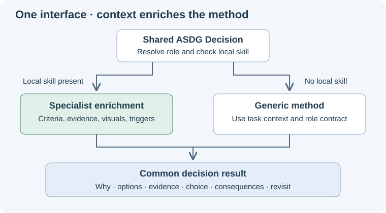

# A shared decision method with optional specialization

Every ASDG specialist now uses the common Decision method. A local skill adds domain judgment when useful; specialists that need no customization keep the generic behavior.

## What changed

The [shared workflow](../../../asdg/skills/asdg-decision/SKILL.md) resolves the role through the existing catalogue and checks its `skills/decision/SKILL.md`.
The [specialization contract](../../../asdg/skills/asdg-decision/specialization.md) defines optional enrichment of framing, criteria, evidence, visuals and revisit conditions.
Missing local methods are normal. Existing but unreadable or conflicting methods are reported explicitly; another role's method is never silently substituted.
The [ASDG-05 local method](../../../asdg/05-high-level-design-and-architecture/skills/decision/SKILL.md) connects architectural criteria to its existing foundations. Other roles use the generic method.
Shared guidance applies across ASDG; the role's existing contract still governs documentation destination and authority.
This is explicit instruction-level dispatch, independent of terminal working directory. It introduces no Python class hierarchy, extra public command or automatic role activation.

## Validation

Both shared and local skills pass the skill syntax validator. The structural verifier and whitespace checks pass.
All 28 portable tests and 3 agent-configuration tests pass; a new regression verifies generic roles need no placeholder and optional local methods survive repeat setup from a specialist subdirectory.
The new diagram and updated guidance were rendered within a 720 px document pane, with images displayed at 656 px; the shared-interface page was visually inspected.
An independent read-only exercise loaded ASDG-05's local method and used generic fallback for ASDG-04, with domain-appropriate criteria and unchanged hashes across 424 fixture files.
Its reported architecture-entry link concern was checked: the relative link correctly resolves inside `asdg/` to an existing shared skill; no repair was needed.
The full package checker retains eight pre-existing external presentation-link failures in unchanged `asdg/README.md`; no other issues were reported.

## Scope and evidence

This authorized methodology update preserves application files, role permissions, catalogue identity, project/sprint/lifecycle state and previous review history.
No placeholder overrides were created for other specialists. Creating a future override remains methodology maintenance, separate from using Decision on a client task.
The [technical receipt](02.4-review-decision-specialization.json) records exact changes, checks and limitations. Fresh native role invocation and runtime enforcement are not established by these tests.
