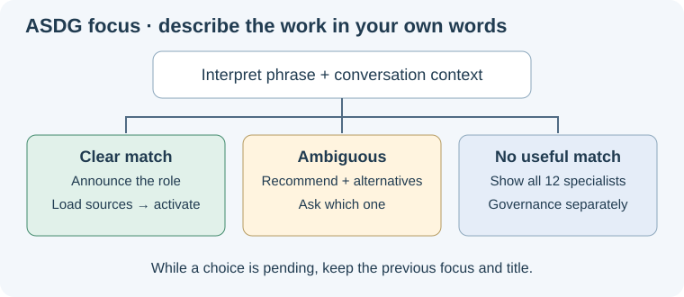

# One Focus entry that understands the user's words

ASDG Focus now interprets a description such as “focus on high level architecture” through the existing role catalogue and conversation context.
The thirteen separate picker shortcuts were removed from this client and its installation templates; all thirteen specialist/coordinator definitions and native role adapters remain.

## Selection behavior

A clear match announces the interpretation and loads the role without another confirmation.

An ambiguous request offers the plausible specialists, a provisional recommendation with a reason, and alternatives; it waits for the user's choice.
If no useful match exists, Focus asks which specialist and lists all twelve, with Governance separately.
Pending questions preserve the previous focus and title. Clear requests return to General; quoted examples and explanation requests do not activate a role.

The [interpretation guide](../../../asdg/skills/asdg-focus/focus-choices.md) supplies responsibilities and clarification behavior, rather than a fixed keyword parser.

## Integration and validation

Installed and packaged discovery now contain only `asdg-focus`; exact template comparisons confirmed the retired shortcuts had no local customizations before removal.
Initializer preflight requires the shared skill and UI metadata and rejects retired per-role Focus templates. Team setup uses the shared skill with explicit catalogue IDs.

All 29 portable tests and 3 agent-configuration tests pass. Both canonical and installed Focus skills pass syntax validation; structure, local links and whitespace checks pass.
The first regression run exposed an existing empty fixture directory after file removal; the fixture setup was corrected to tolerate it, and all 29 tests passed on rerun.

An independent read-only exercise covered nine interpretation cases, including contextual 04/09 and 05/08 distinctions, typos, no match, clear, explanation-only requests and clarification answers.
That exercise tested interpretation, not native activation, renaming or UI cache refresh. A provisional recommendation is contextual judgment, not an accepted selection.

The new guide and diagram were rendered and inspected at a 720 px pane width with a 656 px image; updated source companions rendered without overflow.
The broader package checker still reports eight pre-existing external presentation links in unchanged `asdg/README.md`; no other failures remain.

## Scope and evidence

Application files, project/sprint/lifecycle state, catalogue identity and prior review history are preserved. No chat was activated, renamed, created or messaged by this maintenance task.
The [technical receipt](02.5-review-conversational-focus.json) records changes, retired-file hashes, checks and limitations; removed-file events preserve the old review binding.
An older client's customized shortcuts require explicit migration; ordinary initialization does not delete them silently.
