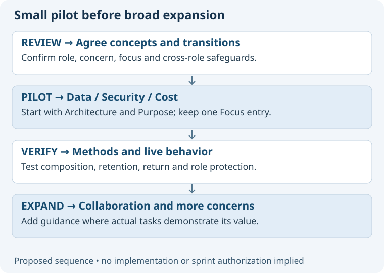

# Review of the Roles, Concerns and Focus proposal

Prepared 27 October 2026 for the user's request to develop a complete strategy while preserving the existing team context.
Subject: ASDG methodology design, not a new Speaker Coach application feature or an implemented skill change.

## Delivered proposal

Start with the [strategy overview](../../../asdg/docs/proposals/roles-concerns-and-focus/README.md).
Thirteen short Markdown files explain the model, twelve concerns, Focus behavior, skill composition, session contract, collaboration, lifecycle perspectives, a Cost example, adoption, and three alternatives.
Ten editable SVGs explain relationships and transitions; every substantive document embeds a relevant visual.
The recommendation is stable roles with temporary concern focus, a shared concern library, optional local enrichment and deliberate cross-role transitions.
User endorsement of vocabulary is preserved separately from acceptance of this implementation proposal.

## Evidence and checks

Source inspection covered current Focus, session policy, team creation, Decision specialization, role/runtime contracts and documentation standards.
The prior conversation supplies requirements and observed navigation; it does not prove the proposed concern behavior works.
All thirteen proposal pages rendered in a 720-pixel pane with loaded diagrams at 656 pixels and no page overflow.
All ten distinct diagrams were visually inspected at embedded width; the overview and skill-composition pages were inspected in full.
Comparison and branching diagrams were corrected to avoid implying that alternative choices form a sequence, then rendered and inspected again.
Markdown source limits, local links, SVG XML and exact receipt hashes are checked by the accompanying validation record.
The local structure verifier passed. The broad checker retains eight pre-existing external presentation links in the unchanged methodology README.
The initial sandboxed Chrome launch failed; the same local render succeeded through the approved execution path.

## Limits and integrity

This is an author-reviewed design proposal, not an independent evaluation, runtime test, human acceptance or implementation.
The acceptance scenarios are specified for a future pilot; none is reported as an executed concern-runtime test.
No application tests were rerun because this delivery adds documentation only.
Existing Focus behavior, role catalogue, lifecycle state, sprint state and application files are preserved; selected hashes are recorded in the [technical receipt](02.6-review-concern-strategy.json).
Only new proposal/review files and append-only documentation receipts are part of this delivery; existing unrelated work remains.
No specialist was spawned, no chat was created or messaged, and no commit, push or lifecycle transition was performed.

## Review next

Review the proposed distinction between stable role and temporary focus, the role-change warning, and the Data/Security/Cost pilot.
If selected, implement the first bounded increment and verify the conversational behavior before expanding the library or parallel execution.
