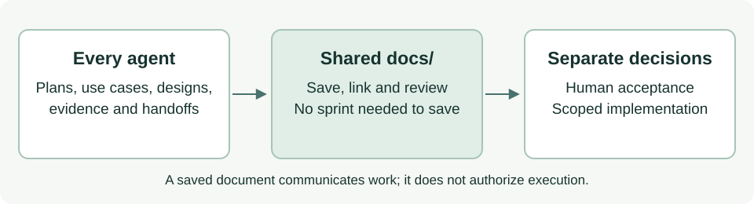

# Shared documentation without an application sprint

ASDG now lets every agent save project documentation and explanatory assets under `docs/` without an active sprint or separate permission to save. Shared documents are the default handoff; direct chat messages can complement them when the user has authorized coordination.

## What changed

The [documentation authority contract](../../../asdg/00-governance/docs/documentation-authority.md) is shared by governance and all twelve specialists. Role entries, procedures, contracts, installed native adapters and their portable templates now use it.
Purpose retains its separate review-recording workflow. Architecture uses the same documentation authority for designs and decision packages.
The managed project instructions, runtime rules, Focus guidance and logging notice no longer tell ordinary documentation authors to stay read-only.
The catalogue's mode and the existing project binding digest were reconciled without changing role identities or lifecycle stages.

The patch guard permits supported documentation formats under client `docs/` without reading sprint state. It still checks every application target in a mixed patch and rejects source-code extensions, policy paths, traversal and symlink escapes from the documentation allowance.
A path/type check cannot establish content semantics: executable application behavior is not authorized merely by placing it in HTML, data or other documentary formats.

## Verification on 28 October 2026

All 57 ASDG tests passed, including four new guard cases covering documentation-only patches, missing or malformed state, mixed code/document edits, moves, policy paths and symlinks.
The project-local `verify` command passed. `git diff --check` passed.
The generic skill validator could not run because PyYAML is unavailable in both checked Python runtimes; the ASDG checker found no changed skill syntax or reference errors.
The portable package checker reports eight existing presentation links escaping this client from `asdg/README.md`; that README matches the starting Git revision and was not changed by this work.
The new editable SVG above was rendered and visually inspected at 720 pixels wide. Existing source-companion visuals were reused; their explanatory relationships remain applicable.
The application/POC sources, evaluation materials, sprint/lifecycle records and hook/configuration files matched their pre-edit hashes.
Native hook trust and interception remain unverified; direct invocation of the configured hook in disposable tests is the available enforcement evidence.

## Limits and handoff

Documentation is not acceptance, implementation or a sprint transition. Existing approval and code gates remain in force.
AI modification receipts preserve earlier events and bind changes to exact file hashes; no human acceptance of the resulting bytes is inferred.
ASDG-03 was asked to finish saving its already assigned question-clarification use case using the revised contract.
