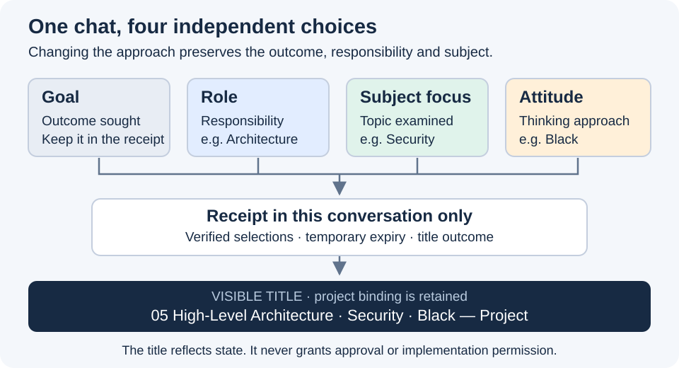

# Independent session fields and readable chat names

This increment adds a thinking attitude and a subject within an existing role. The goal remains in the conversation receipt.
It implements the 28 October brief using embedded ASDG; OpenSpec and application development remain separate work.

## What changed

- `$asdg-focus 05` still selects High-Level Architecture; `$asdg-focus subject Security` changes only the subject.
- `$asdg-attitude Black` selects a thinking approach; Green and Off change that approach without losing role, subject or goal.
- English/Spanish selections, read-only status, explicit temporary scopes and restoration are defined in the [attitude guide](../../../asdg/skills/asdg-attitude/attitudes.md).
- Titles project the verified role, subject and attitude. Failed renaming preserves valid state and produces a truthful receipt.
- Focus, Status, Role, Suggestion and team setup share the [session contract](../../../asdg/skills/asdg-focus/session-state.md); templates include the portable discovery adapter.

The unscoped default—retain the attitude until changed or Off—is **proposed for pilot review**, not recorded human acceptance.
These are agent instructions and conversation receipts; they add no shared session-state file or new persistence service.

## Evidence

| Check | Result |
| --- | --- |
| Starting point | Clean worktree at `b49a6994a554d3e3a99f6f2bf1d51d53d5246fad`. |
| Regression suite | 58 tests pass; includes Attitude installation, relocation and repeat-setup preservation. |
| Project structure | `python3 -B asdg/scripts/cli.py verify` passes. |
| Package checks | Eight unchanged, pre-existing sibling presentation-link failures; no new package issues. |
| Generic skill validator | Unavailable because PyYAML is missing; package skill syntax checks ran. |
| Visual | New editable SVG rendered and inspected at 720 px; embedded Markdown preview not inspected. |
| Native exercises | Two authorized Architecture chats retained separate subjects; Black → Green → Off, one-answer expiry, read-only status, quoted commands and invalid Purple input behaved as specified. |
| Titles | Native RENAMED and UNCHANGED observed. Performance's readback was shortened; an explicit Perf. display label produced an exact readback while retaining the full subject. |

Application files, project/lifecycle/sprint state, hook definitions, native role adapters and approval history are protected from this change.
Modification receipts record changed document hashes; they neither approve the increment nor transfer existing acceptance to new bytes.

## Review and limits

Native resume/compaction, picker refresh, named-review/nested expiry and unavailable/failed rename branches remain unverified; source rules alone do not prove them.
Tests used the installed skill paths and native chat tools. A shortened readback does not by itself establish storage or visual UI clipping.
The author also ran these checks; test chats share the same sources and are not an independent review.
No commit, push, sprint transition, hook-trust change or OpenSpec installation was performed.
Review the persistence default and the observed title behavior before the next ASDG/OpenSpec increment.

[Exact diff](02.8-review-attitude-and-session-naming.diff) · [Commands, changed paths and native receipts](02.8-review-attitude-and-session-naming.json) · [Behavioral exercise](../../../asdg/skills/asdg-attitude/TRY-IT.md)
