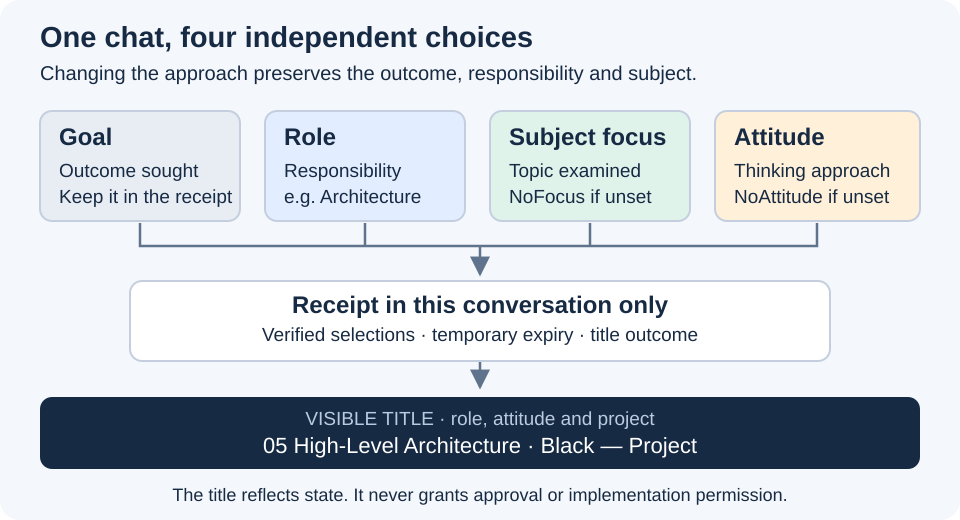

# Shorter session names

Pablo requested a simpler title after reviewing the attitude pilot on 28 October 2026.
The title now shows **role · attitude — project**. Subject focus stays in the conversation receipt and Status.

## Naming rules

| Situation | Display |
| --- | --- |
| Governance, no selected attitude | `00 Governance · NoAttitude — SpeakerCoach` |
| Architecture, Black attitude | `05 High-Level Architecture · Black — SpeakerCoach` |
| No selected subject | `Focus: NoFocus` in the reply and receipt; omitted from the title. |

`Off` remains an accepted input alias, but the resulting label is NoAttitude. A known unset subject formerly recorded as None becomes NoFocus.
Unknown history stays Unknown. Subject-only changes no longer rename the chat; different subjects can legitimately share a title.
Skills, discovery templates, usage guidance and acceptance scenarios use the new convention. Stable thread IDs still identify distinct chats.

## Verification and preservation

Project structure verification passes. The package checker reports only the same eight pre-existing external presentation links.
The updated SVG was rendered and visually inspected at 720 px. This instruction-only correction adds no implementation test.
Native renaming acknowledged the new Governance title and both existing Architecture test titles; this chat's exact title was also read back.
The two test chats retain their separate Security and Performance receipts. No new chats, peer messages or role/attitude selections were made.
Previous pilot evidence remains historical; this review supersedes its naming convention without rewriting its results.
Existing uncommitted work was preserved. Application code, sprint state, hooks and approval decisions were not changed; no commit or push occurred.

[Naming contract](../../../asdg/skills/asdg-focus/rename-chat.md) · [Incremental diff from the pre-edit working tree](02.9-review-short-session-names.diff) · [Previous pilot](02.8-review-attitude-and-session-naming.md)
