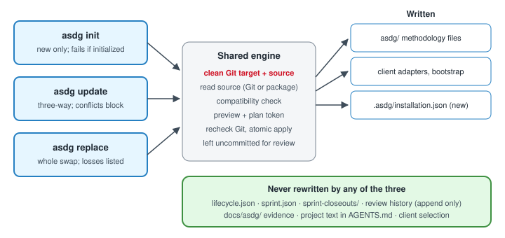

# ASDG installation lifecycle: init, update and replace

This plan implements the approved installation architecture for the embedded ASDG methodology, using SpeakerCoach (Alice) as the pilot client.
Three commands replace today's overloaded `init` and the `upgrade` sync, without reinitializing any project or losing its history.

## The three contracts

- **`asdg init`**: new installations only; it fails if the project is already initialized.
- **`asdg update`**: a controlled methodology revision update, with conflict detection and preservation of local edits.
- **`asdg replace`**: an explicit methodology replacement that preserves lifecycle state, evidence and configuration.

## Why it is needed

Intended: each command has one job, and installation history is recorded.
Actual, observed on 13 November 2026: `init` accepts initialized projects and doubles as the adapter refresh, `upgrade` only syncs between two Git repositories, and nothing records a replacement.
Alice's `asdg/` was swapped by hand from 0.2.0-pilot.2 to 0.3.0-pilot.4, so status reports `INVALID` and the sprint gate blocks all implementation, including SPRINT-002.

## Rules every command follows

1. **Clean Git first (mandatory).** Preview and apply require a clean consumer working tree and a clean Git source at the selected revision; see [Git preconditions](03.5-asdg-install-git-preconditions.md).
2. Preview, then apply only with the exact plan token; any repository or input change invalidates it and needs a fresh preview.
3. Methodology files, adapters and the installation record are written in one atomic apply, verified before success is reported.
4. Never rewritten: `lifecycle.json`, `sprint.json`, `sprint-closeouts/`, existing review events, `docs/asdg/`, project text in `AGENTS.md`, and client selection unless `--client` is given.
5. No commit, stage, stash, reset, clean, push, hook trust, sprint change or approval as a side effect; results stay uncommitted for human review.
6. The source is a Git clone at an exact commit or tag (primary) or an unpacked package (fallback), and its kind is recorded.

## Plan documents

- [State and sources](03.2-asdg-install-state-and-sources.md): the installation record and the two source kinds.
- [Increments and tests](03.3-asdg-install-increments.md): thirteen bounded steps with completion evidence.
- [Reconciling Alice](03.4-asdg-install-alice-reconciliation.md): adopting the manual swap without reinitializing.
- [Git preconditions](03.5-asdg-install-git-preconditions.md): the clean-tree invariant, failure codes and corrective actions.

## Decisions needed before increment 1

- **D1 How the swap is committed**: the clean-tree rule requires a human commit of the swapped folder before reconciliation; one commit for the swap alone (recommended), or together with other pending work.
- **D2 Where code lives**: implement in Alice's embedded `asdg/` and promote later (recommended), or build in the canonical repository.
- **D3 Network fetch**: allow a later `--fetch <tag>` shallow clone of a named ref, or keep local sources only (recommended for now).
- **D4 Gate while unrecorded**: keep blocking implementation with a precise reason (recommended), or warn and allow.

## Status and provenance

Proposed; not accepted, not scheduled and not part of SPRINT-002, whose scope excludes `asdg/`.
Methodology edits require explicitly selected ASDG Admin within a human-authorized scope.
Requested by Pablo on 13 November 2026 after approving the architecture; drafted by Claude (Opus 5.5), saved under 07 Planning.
The canonical ASDG repository was not read or changed.
Return to [Planning](README.md).
