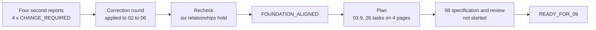

# SPRINT-003 alignment report: version 4

SPRINT-003 gives Alice (Alice.Good.Meetings) a new page layout and a proposed answer: a few short points beside the Focus question and supporting details below, built from the question and Pablo's interview preparation package. The sprint was restarted on 18 November 2026 with nine criteria. This version reconciles the four second first-pass reports and the amended stage pages. Version 3 keeps its bytes in [03.7](03.7-sprint-003-alignment-report.md) and is superseded for the amended record.
**Result: `FOUNDATION_ALIGNED`.** The six relationships hold for the twelve commitments, with one wording item for Purpose (R1) that changes no behavior. The sprint is not yet `READY_FOR_09`: Detailed Design has not written the specification, and nothing has been reviewed.

*The result moved from four change requests to aligned after the owners applied their amendments and Pablo decided the last two questions.*

## Identity

| Item | Value |
| --- | --- |
| Sprint | SPRINT-003, active, branch `sprint-03`; snapshot `.asdg/sprint.json` SHA-256 `90d6dab6bb3d43b1b16d71a153796a27c3c757339a4291682d7d979b05d69131` |
| Git | HEAD `fe3c00edc3ca4008b0b203317593acb6ab87e851`; the stage corrections are uncommitted |
| Observed | Version 4 on 18 November 2026, after the correction round |
| Direction | Pablo, as relayed by 00 Governance on 18 November: "Accept all" on twelve defaults, then "Accept both" on the last two (no package notice before Start; details scroll inside themselves with no collapse control). Planning did not see his messages |

## What the four reports found and what happened

| Stage | Report | Verdict then | Now |
| --- | --- | --- | --- |
| 02 | [Purpose](../02-purpose/03.3-sprint-003-purpose-alignment-v2.md) | `CHANGE_REQUIRED` | Four of five amendments applied; D1 decided; one wording item (R1); capabilities refresh waits for closeout |
| 03 | [Use Cases](../03-system-model-and-use-cases/03.1-sprint-003-use-case-review-v2.md) | `CHANGE_REQUIRED` | A1 to A3 applied; A4, a package notice, withdrawn by Pablo's decision |
| 04 | [Evaluation](../04-benchmarks-and-eval-strategy/03.7-sprint-003-evaluation-review-v2.md) | `CHANGE_REQUIRED` | All five gaps answered in the plan and live-session pages |
| 05 | [Architecture](../05-high-level-design-and-architecture/03.3-sprint-003-architecture-review-v2.md) | `CHANGE_REQUIRED` | A1, A3, A4, A5 applied; A2, the notice, withdrawn |

[Reconciliation](03.10.1-sprint-003-reconciliation.md) holds the six relationships and the specific checks. [Sources](03.10.2-sprint-003-reconciliation-sources.md) holds every hash. The reports were written on the old bytes; this version reads the amended pages. The 06 [POC decision](../06-viable-proof-of-concept/03.1-sprint-003-poc-decision.md) is refreshed for twelve commitments: still no POC, no new experiment.

## What remains before `READY_FOR_09`

1. **R1:** 02 replaces "at Start" with "on load, before Start" (T01). Wording only.
2. **T02:** Pablo confirms that criterion 9's "only" means the answer request, as 05 scopes it. No sprint command.
3. **T10 to T13:** 08 creates the OpenSpec change and the specification; 04 writes the two check procedures.
4. **T14:** Pablo reviews the specification; 10 checks it against the nine criteria; 00 Governance records `READY_FOR_09`.
5. Open design points the specification must close: the preview's control placement (C9) and bullet length, the delay measurement point for speech start, and the loader's start log.
After that: the [plan](03.9-sprint-003-plan.md) schedules the preview, the build, the page check, the shell check of `poc/alice-run.sh`, the package check, N5 (Governance edits root `AGENTS.md`, 09 Coding edits `poc/README.md`) and the live session.

This version is a draft that approves nothing, changes no state and starts no work. Prepared by 07 Planning under the [report contract](../../../asdg/skills/asdg-sprint-align/report.md). Return to [Planning](README.md).
