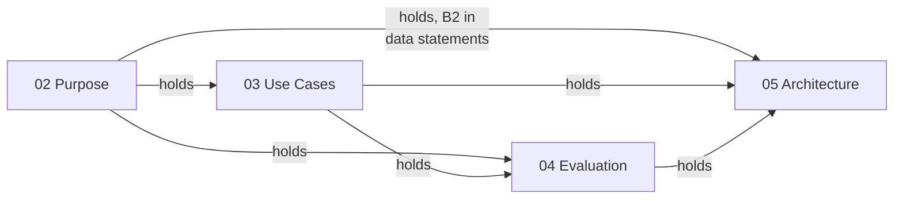

# SPRINT-003 reconciliation: the six relationships against twelve commitments

This page belongs to the [alignment report v4](03.10-sprint-003-alignment-report-v4.md). It judges meaning, not wording, using the four second first-pass reports and the amended stage pages as they stand after the correction round. Hashes are on the [sources page](03.10.2-sprint-003-reconciliation-sources.md). Every page is a draft; "decided" rests on 00 Governance's relay of Pablo.

*All six relationships hold for the twelve commitments after the correction round. One wording item in Purpose remains (R1).*

## The six relationships

| Relationship | Result | Basis |
| --- | --- | --- |
| Purpose → Use Cases | Holds | Purpose's glance, own-answer and no-invention rules appear in UC-05 and the seven states. General points without a package, now in both. Details scroll inside themselves in both |
| Purpose → Evaluation | Holds | The glance check, the live pass rule and the author-as-judge limit match Purpose's attention constraint; the plan says one session shows acceptance, not benefit |
| Purpose → Architecture | Holds | The key stays local; the data flow sends only the question, fixed instructions and the package to the answer request. B2 is carried by the data statements |
| Use Cases → Evaluation | Holds | All seven states, the three no-key cases, the oversized package and one retry have a layer 1 or layer 2 check |
| Use Cases → Architecture | Holds | Replace on every Focus change, Unavailable on load with Start disabled, last known after Stop, and one retry agree with 01.3, 01.4 and 01.5 |
| Evaluation → Architecture | Holds | Injected generator and transcription fixtures drive all states; the request object is inspectable; `/health` marks the start |

## Specific checks asked for

| Check | Finding |
| --- | --- |
| B2 lives in the data statements | **Yes.** [03-data-statements.md](../05-high-level-design-and-architecture/decisions/Proposed%20answer%20and%20its%20context/03-data-statements.md) carries the wording, and Purpose's B2 row names the same two pages. The two target pages, root `AGENTS.md` and `poc/README.md`, still have the old text until T31 and T32; that is intended, since the behavior does not exist yet |
| Nothing mentions a pre-session package notice | **Holds.** Every mention found is a negation: 02 (B2 row, decision 6, planned improvements), 04 (plan), 05 (01.4, data statements). The proposed notice in the 03 and 05 reports (A4 and A2) was not applied. No `/health` usable flag was added |
| Details scroll is consistent everywhere | **Holds.** 02, 03, 04 and 05 say the details area scrolls inside itself with no collapse control; no page still says "collapsed". Pablo's 18 November decision is cited in each |
| When Unavailable appears | **R1, wording.** 02 says a missing key shows the unavailable state "at Start"; 03, 04 and 05 say on load, before Start, with Start disabled. Purpose leaves timing to Use Cases and Architecture, and no commitment differs, so this is a wording correction for 02 (task T01), not a disagreement of meaning |
| Retry count | One service retry, so at most two tries, in 03, 04 and 05 |
| Criterion 9's "only" | 05 scopes it to the answer request. The record keeps its text; T02 asks Pablo to confirm the reading |

## The twelve commitments

No commitment lacks a rationale, a scenario or obligation, a criterion with a method, and architectural support. S003-PAGECHECK, S003-TESTS, S003-RUN and S003-STATEMENTS are technical and trace to the attention constraint, the 4 November replacement defect and the honesty of the data statements. The reverse check found one addition with no criterion: the optional print option, which Pablo accepted as a default; T25 marks it droppable.
Return to the [report](03.10-sprint-003-alignment-report-v4.md) or to [Planning](README.md).
