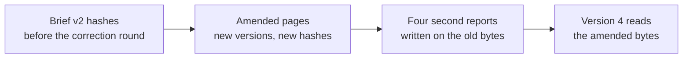

# SPRINT-003 reconciliation: sources and hashes

This reference page belongs to the [alignment report v4](03.10-sprint-003-alignment-report-v4.md). Hashes are SHA-256 of the working-tree files read on 18 November 2026, after the correction round. Git HEAD is `fe3c00edc3ca4008b0b203317593acb6ab87e851`, the sprint snapshot `.asdg/sprint.json` is `90d6dab6bb3d43b1b16d71a153796a27c3c757339a4291682d7d979b05d69131`, and the brief v2 is `58a423ee370518772ceb2e6a51370dfb62048a8f89e49b90a9b2fade49257f16`.

*The four second reports were written before the corrections. Version 4 judges the pages that exist now, so these hashes replace the brief's for the pages below.*

## Pages changed or added since the brief

Thirteen listed pages of the brief are unchanged and keep their hashes: Stage 02's current capabilities, Stage 03's UC-01 to UC-03, Stage 04's strategy and evidence page, Stage 05's architecture, streaming, interview-state, current-architecture, planned-decisions, delay and decision-record README pages.

| Stage | Page | SHA-256 |
| --- | --- | --- |
| 02 | [01-purpose.md](../02-purpose/01-purpose.md) | `fcc0d8b95d8e8a0ca416db4c4da688a590576e4b676eb6b6b2f1285d3bc310b3` |
| 02 | [03-planned-improvements.md](../02-purpose/03-planned-improvements.md) | `7d57ea398f30e9dcd19b6acbfb7feb98956cbe8033377799e19a01072955a96d` |
| 02 | [03.2-sprint-003-prepared-context-proposal.md](../02-purpose/03.2-sprint-003-prepared-context-proposal.md) | `9397da552253abe77750fc0be1484ed4c703229a7f15cc9c4d51ecc5f7c09a43` |
| 02 | [README.md](../02-purpose/README.md) | `9a26bda55934b248f456e50aba0cdf5f267e89c02b3317187633ee9366c81543` |
| 02 | [03.3-sprint-003-purpose-alignment-v2.md](../02-purpose/03.3-sprint-003-purpose-alignment-v2.md) | `b1c1a1814d10ad7c96bba154e0ab24817606e1fe316454eee296c1948b0a8b91` |
| 03 | [01-system-model.md](../03-system-model-and-use-cases/01-system-model.md) | `f424d777ac7c6c73b272dcfda0d0d2d6a905d573d821230064bab2eb9a3efae3` |
| 03 | [01.4-confirm-current-question.md](../03-system-model-and-use-cases/01.4-confirm-current-question.md) | `66e6b8b29372d6c1d08c82130dc4dfbe5f8bb65c57f85e3baed787c14365b45e` |
| 03 | [01.5-proposed-answer.md](../03-system-model-and-use-cases/01.5-proposed-answer.md) | `ce55eef27d477622c8a71ff0536442edcac236f411bc37e71de4298b1d58379f` |
| 03 | [01.5.1-proposed-answer-states.md](../03-system-model-and-use-cases/01.5.1-proposed-answer-states.md) | `669ff1a4f7bb928a4ae994c093a4d07747edbb8e76930559535ae9dc2126ec6a` |
| 03 | [03.1-sprint-003-use-case-review-v2.md](../03-system-model-and-use-cases/03.1-sprint-003-use-case-review-v2.md) | `03078f84b82d0e6eca6e9235f1f906cb6f2e8333ec1a812ff85c620b1a068704` |
| 04 | [01.2-evaluation-criteria.md](../04-benchmarks-and-eval-strategy/01.2-evaluation-criteria.md) | `66551232ea442d0adb60056e86fc4c7e016abc52d378a4f3c1ce123db19e832d` |
| 04 | [03.6-sprint-003-evaluation-plan.md](../04-benchmarks-and-eval-strategy/03.6-sprint-003-evaluation-plan.md) | `ab96d2b8c1f5ddec7ba47f335cee65bb703bcdddab6213911c6789156c88dc2c` |
| 04 | [03.6.1-sprint-003-live-session.md](../04-benchmarks-and-eval-strategy/03.6.1-sprint-003-live-session.md) | `9346a8136bc0d7444ca6f6bd8c8c2c608588dcc4d5751cf7e47c60aea50566f3` |
| 04 | [03.7-sprint-003-evaluation-review-v2.md](../04-benchmarks-and-eval-strategy/03.7-sprint-003-evaluation-review-v2.md) | `eb3640e6c371bebeb55afc38b6b5636fe3e18e9af5402325bfd52b113d6c14eb` |
| 05 | [01.3-proposed-answer.md](../05-high-level-design-and-architecture/01.3-proposed-answer.md) | `ff2d93c2887595e96c2eb45a0fe0f4a8e971f847b9a4385c69d3897ae53ea129` |
| 05 | [01.4-service-start-and-key.md](../05-high-level-design-and-architecture/01.4-service-start-and-key.md) | `3bfa4c77464d1ce0fdd5f4ec3ea3882e716f94ad16cb80d4b415e290fa2c5d49` |
| 05 | [01.5-pending-state-and-inspectable-inputs.md](../05-high-level-design-and-architecture/01.5-pending-state-and-inspectable-inputs.md) | `981c5c430435cd509c04de9bd4043427f5238a1a9fefa9121595ea692521d4be` |
| 05 | [02-preparation-package.md](../05-high-level-design-and-architecture/decisions/Proposed%20answer%20and%20its%20context/02-preparation-package.md) | `14cb7837e65958e87eb275338bd72d409f04331d0d6a520085360cf5d799e824` |
| 05 | [03-data-statements.md](../05-high-level-design-and-architecture/decisions/Proposed%20answer%20and%20its%20context/03-data-statements.md) | `466fb948365845dfe948b90e9d54d8cd915043e7fda26e6125e69a04b43edc03` |
| 05 | [03.3-sprint-003-architecture-review-v2.md](../05-high-level-design-and-architecture/03.3-sprint-003-architecture-review-v2.md) | `b5b49bdb98e10f3db5426248d052e8d6e2068cf73051a084efd2754463517e5e` |
| 06 | [03.1-sprint-003-poc-decision.md](../06-viable-proof-of-concept/03.1-sprint-003-poc-decision.md) | `8b6daba93e4136d265b41785388f3a31b85834280d88a5ae0fbee39a950c06cf` |

Other evidence: root `AGENTS.md` `54355e32e14b85930ddb09b8010a7ec022e9ce80ae19a12979d7054c8b170d5f` and `poc/README.md` `6352e2a8fe8eb59c6d6a64d50be5650ad816e94fd83582a582a4c31ce0c2a28c`, unchanged and awaiting T31 and T32. `poc/alice-run.sh` does not exist and `openspec/changes/` holds only the UC-04 change and an archive.
Each of the four reports states the hashes it relied on; they equal the brief's, not these. A report conclusion is current only where the amended page agrees with it, which [the reconciliation](03.10.1-sprint-003-reconciliation.md) checked. Return to [Planning](README.md).
