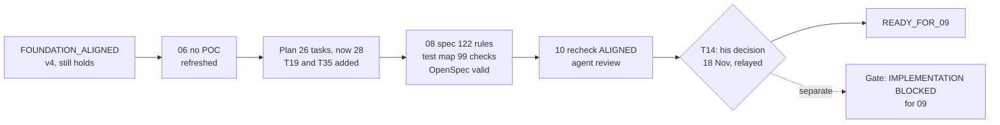

# SPRINT-003 alignment and readiness report: version 5

SPRINT-003 gives Alice (Alice.Good.Meetings) a new page layout and a proposed answer: up to three short points beside the Focus question and details below, built from the question and Pablo's interview preparation package. This version applies the [readiness rule](../../../asdg/skills/asdg-sprint-align/readiness.md) after Detailed Design wrote the specification and test map, 04 wrote its two check procedures and 10 Review and Release reviewed the specification. Pablo then accepted the fixes. Versions [3](03.7-sprint-003-alignment-report.md) and [4](03.10-sprint-003-alignment-report-v4.md) keep their bytes.
**Result: `READY_FOR_09` for documentation.** On 18 November 2026 Pablo said: "I am in a hurry and I feel the specs are very clear so I am accepting all the align fixes and will review the running application." That is his stated decision on the specification review (T14), relayed by 00 Governance. It is not a formal approval of exact page hashes, and he did not say he read every page. Implementation by 09 is still blocked by the gate (below), which is a separate condition.

*His decision answers T14. The gate is a separate condition on 09, not on documentation readiness.*

## Identity

| Item | Value |
| --- | --- |
| Sprint | SPRINT-003, active, branch `sprint-03`; snapshot `.asdg/sprint.json` SHA-256 `90d6dab6bb3d43b1b16d71a153796a27c3c757339a4291682d7d979b05d69131`, unchanged |
| Git | HEAD `fe3c00edc3ca4008b0b203317593acb6ab87e851`; all stage, plan, specification and OpenSpec work is uncommitted |
| Observed | 18 November 2026, after T01, T02 and T10 to T13 |
| Direction | Pablo, as relayed by 00 Governance: T02 "Yes, answer request"; "Accept all" on R1 to R10 and on the reviewer script location `poc/review/package-check.mjs`. Planning did not see his messages |

## What his decision covers, and what it does not

- **Covers:** the correction rounds and the specification as written, including R1 to R10 (accepted earlier, as relayed), T02 and the reviewer script location. It is his recorded outcome for T14.
- **Does not cover:** a formal document approval. No page hash is approved; `/asdg-approve` is his to run and nothing here edits `.asdg/`.
- **Left to him, on the running application:** the layout (criterion 1, T21), at a glance (criterion 2) and the live session (criterion 7, T40), as the plan already says. Provisional limits stay open until T21 and T22.

## Conditions for 09: the gate and the root file

`python3 asdg/scripts/cli.py sprint check-implementation --path poc/server.mjs`, re-run by Planning on 18 November 2026, reports `IMPLEMENTATION BLOCKED`: `.agents/skills/asdg-pre-code-review/SKILL.md: missing or locally modified integration`. The new adapters are listed in package metadata but not generated. A human with ASDG maintenance authority repairs it, then `asdg verify` and the check run again for every path. Also a condition for 09: root `AGENTS.md` has 54 nonblank lines and the update engine refuses the adapter refresh above 50; Pablo's decision on shortening it is pending. This changes no readiness fact and no sprint.

## Where the rest is

[Readiness rule check](03.11.1-sprint-003-readiness-rule-check.md): each bullet of the rule, human versus agent evidence and freshness. [Remaining work](03.11.2-sprint-003-remaining-work.md): the gate, tasks T14 to T43, N5 and open items. [Sources A](03.11.3-sprint-003-readiness-sources-spec.md) and [B](03.11.4-sprint-003-readiness-sources-other.md): hashes.
This version is a draft that approves nothing, changes no state and starts no work. Prepared by 07 Planning under the [report contract](../../../asdg/skills/asdg-sprint-align/report.md). Return to [Planning](README.md).
