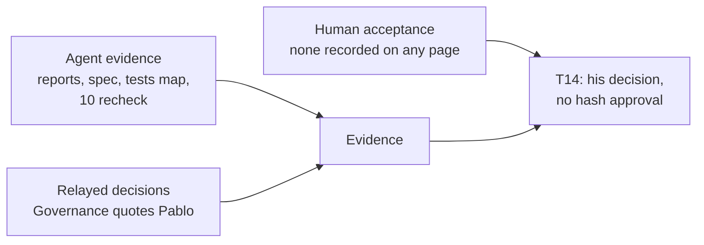

# SPRINT-003 readiness: the rule, point by point

This page belongs to the [readiness report v5](03.11-sprint-003-readiness-report-v5.md). It checks each point of the readiness rule, separates human acceptance from agent review, and records what changed since version 4. Hashes are on the sources pages.

*Three kinds of evidence. Only the third counts as acceptance, and no page records it.*

## The rule

| Point of the rule | Finding |
| --- | --- |
| Four first-pass contributions complete, compatible, relationships reconciled | **Met.** The four reports of 18 November were written on pre-correction pages; v4 reconciled the amended pages. Three pages changed since, all wording: 02's planned improvements and package page (R1: the unavailable state is "on load"), and 04's plan (a rejected key shows Unavailable once a session starts, as 08's R2 chose; the service refuses an over-limit result). No rule or commitment changed |
| Every commitment covered, no contradiction or missing decision | **Met.** Twelve commitments map to rules, checks and tasks. R2 conflicted with the plan and is now consistent; no contradiction found; T14 answered by Pablo's decision of 18 November |
| Evaluation observable, Architecture supports | **Met.** 04's [03.8](../04-benchmarks-and-eval-strategy/03.8-sprint-003-package-and-statement-checks.md) completes the package and statement checks; the specification fixes the request object they compare |
| POC decision recorded, findings incorporated | **Met.** [06](../06-viable-proof-of-concept/03.1-sprint-003-poc-decision.md): no POC, delay learned live; its speech-start condition is rule TM-5 |
| Plan and specification suffice, with traceability and review evidence | **Met, with two additions.** 122 rules and 99 checks, forward and reverse tables identical, OpenSpec change `sprint-003-proposed-answer` valid by Governance's `openspec validate --strict` (not re-run by Planning). The plan gained T19 (baseline sizes, owner unassigned) and T35 (reviewer script), both already in the OpenSpec tasks |
| Inputs current, nothing unselected | **Met, one housekeeping gap.** Every new rule traces to a criterion. The OpenSpec proposal lists two stale source hashes (04 plan, 03.8); 08 refreshes them before apply |

## Human acceptance versus agent review

| Item | Kind | Status |
| --- | --- | --- |
| Four stage reports, 10's recheck | Agent review | Complete; carries no approval |
| R1 to R10, T02, script location, "Accept both" | Relayed direction | Decided; recorded in pages as relayed |
| Specification review (T14) | Human decision, relayed | "I am accepting all the align fixes and will review the running application." Not a formal approval; not a claim he read every page |
| Layout, by hash (T21) | Human | Not yet possible; needs a preview |
| Live session (T40) | Human | Not yet possible |

No page or `.asdg/document-reviews.json` entry records approval of any page; AI receipts record authorship only. A changed page inherits no earlier acceptance.
The housekeeping items from 10's recheck, none blocking: SH-15 is a reviewer gate on `index.html` and is labelled among the shell checks of `alice-run.sh`; 03.8 item 3 still says "proposed for 08"; OpenSpec task 2.1 cites PK-1 to PK-10 but verifies ST-57.

## Freshness

Dependencies are the sprint snapshot, the amended criteria and the pages on the sources pages. A change to any rule, criterion or cited claim invalidates what depends on it; a wording edit needs an impact assessment, which this page records for the three changes above.
Return to the [report](03.11-sprint-003-readiness-report-v5.md) or to [Planning](README.md).
