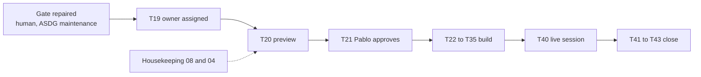

# SPRINT-003 readiness: what remains

This page belongs to the [readiness report v5](03.11-sprint-003-readiness-report-v5.md). It lists what remains after documentation readiness: the gate for 09, the plan's tasks, the data statements (N5) and the open items. Task IDs are on the [plan](03.9-sprint-003-plan.md).

*Nothing in this chain has started. Pablo's own review comes at T21 and T40, on the running application.*

## Done since version 4

T01 (02), T02 (Pablo's "Yes, answer request"), T10 to T13 (08 and 04), and T14 (his decision of 18 November, relayed). T10 to T13 are drafts by agents with no hash approval.

## Before 09 may edit anything

1. **The gate.** Repair the unregistered `asdg-pre-code-review` and `asdg-presentation` adapters so `check-implementation` passes; Planning observed only the first named in the error. A human decides and runs it; Planning ran no repair.
2. **T19.** Governance assigns an owner for the baseline text sizes (10 ReviewQA is proposed, and it must not be the builder).
3. **Housekeeping, none blocking:** 08 refreshes two stale hashes in the OpenSpec proposal and labels SH-15 as its own gate; 04 corrects item 3 of 03.8; 08 corrects the wording of task 2.1.
4. **Root `AGENTS.md` length.** It has 54 nonblank lines, and `init --dry-run` refuses to plan the adapter refresh above 50 ("shorten its project-owned guidance first"). 00 Governance proposed to Pablo pointing the install and start sections at `README.md`; his decision is pending. T31's sentence must fit the limit, and only Pablo or a selected ASDG Admin can edit that protected file.
5. **Hook trust** is not assessed; the gate stays behavioral until a human trusts the hooks.

## The plan from here

| Tasks | Owner | State |
| --- | --- | --- |
| T20 preview; T21 approval by hash | 09; Pablo | Not started; needs the gate |
| T22 limits from the preview | 08 | Not started |
| T23 to T29, T35 service, page, run script, reviewer script | 09 | Not started |
| T27, T28, T30 service tests, page check, shell check | 09; 10 reviews T30 | Not started |
| T31 root `AGENTS.md` statements | Pablo or ASDG Admin, on his instruction | Not started; after T27; file over 50 lines |
| T32 `poc/README.md` statements | 09 | Not started; inside the sprint gate |
| T33, T34 statement and package checks | 04 | Not started |
| T40 live session; T41 review; T42 refresh; T43 close | Pablo; 10; stages; Pablo | Not started |

## Open items

C3 is specified (`/health`, no key file) but unobserved until T30. C9 control placement waits for T21. C11 is answered by the page check in criterion 5 and T28. C15, the product name and the test count, stays minor; the spec says 19 existing cases. C16 is closed by the restart. C18 closes at T31 to T33.
Return to the [report](03.11-sprint-003-readiness-report-v5.md) or to [Planning](README.md).
